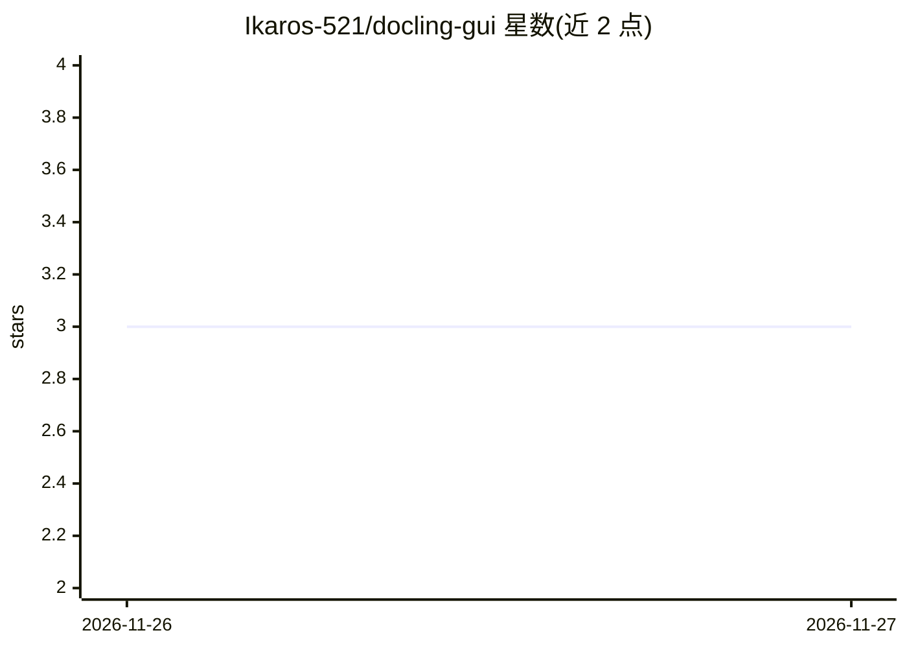

# Ikaros-521/docling-gui

⭐ 3 · Python · MIT · 推送 2026-11-16 · [GitHub](https://github.com/Ikaros-521/docling-gui) · [官网](https://github.com/Ikaros-521/docling-gui/releases) · 个人维护 · 中文 README

**给 docling 提供免代码桌面图形界面的批量文档转换工具**

为 IBM 开源文档解析引擎 docling 提供的免费桌面 GUI：递归批量把 PDF、Word、Excel、PPT、图片、音频等 37 类格式转换为 Markdown/HTML/JSON/DocTags/纯文本。完全本地离线运行，文档不出本机；GUI 与命令行双模式，支持断点续转、输出目录镜像、中英文界面。Windows/macOS/Linux 提供免安装压缩包，也可源码运行（Python ≥3.10）。旧版 Office 依赖系统 LibreOffice，视频转写依赖 ffmpeg。

## 筛选速览

| 维度 | 判定 | 备注 |
|---|---|---|
| AI 角色 | `ai-enhanced` | 去掉 AI 部分产品仍成立 |
| 许可风险 | `permissive` | MIT |
| 部署形态 | `library` | 以包/库形式分发 |
| 模型依赖 | — | README 未给出锁定关系 |
| 硬件要求 | — | 无带数字的原话,不猜 |
| 安装摩擦 | `medium` | 含编译或系统依赖之一 |
| 成熟度 | — | 结构信号不足 |

## 能力要点

- 37 类输入格式（docling 全部支持格式）递归批量转换
- 五种输出格式，含 DoclingDocument 无损 JSON
- v0.5.0 起安装包内置 PDF/图片管线模型，开箱离线可用
- GUI + 命令行双模式，可中断、断点续转

## 适用场景

- 批量把 PDF/Word 转成 Markdown 导入 Obsidian、Logseq、Notion
- 为大模型/RAG 做文档数据预处理
- 扫描件与图片 OCR 转可检索文本
- 批量归档旧版 .doc/.xls/.ppt 文档

## 场景标签

`文档解析` `OCR` · 领域:知识与检索

## 证据(README 行号)

> L10: **Docling GUI 是一款免费开源（MIT）的批量文档转换桌面应用**，为 IBM 开源文档解析引擎
> L113: A：docling 是 IBM 开源的文档解析引擎（Python 库 / CLI）；Docling GUI 是它的桌面图形界面 +
> L14: 支持 Windows / macOS / Linux，**完全本地离线转换、无需编写代码，文档不出本机**。

## 星数曲线

2026-11-26 3 → 2026-11-27 3（+0）

---
*卡片 v1 · prompt 1.4 · 生成 2026-11-26 · 置信度 high · 依据 README sha `47e98e3df76a` · [字段定义](../../DATASET.md)*
