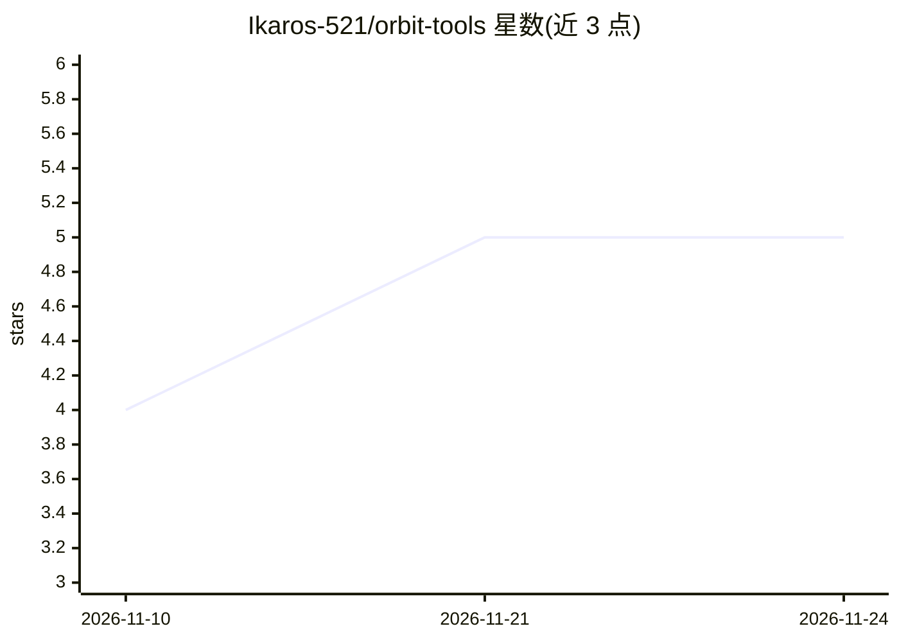

# Ikaros-521/orbit-tools

⭐ 5 · JavaScript · NOASSERTION · 推送 2026-11-23 · [GitHub](https://github.com/Ikaros-521/orbit-tools) · [官网](https://ikaros-521.github.io/orbit-tools/) · 个人维护 · 中文 README

**给开发者的开源 uTools 风格插件化工具箱，含 AI Agent 对话**

基于 Electron 的插件化桌面开发工具箱，内置 13 个插件：截图悬浮（含 OCR）、屏幕画板、录屏标注、剪贴板历史、JSON 编辑器、编码转换、取色、Markdown 备忘录、端口进程查看、镜像源切换、计算器与本地 AI Agent 对话。每个插件是一个文件夹（plugin.json 清单 + 面板脚本 + 可选主进程后端），复制到用户目录即安装、可覆盖内置插件；全局热键统一注册并有冲突检测与自动降级。提供 Windows/macOS/Linux 安装包与内置更新器。采用 AGPLv3 + 商业授权双许可。

## 筛选速览

| 维度 | 判定 | 备注 |
|---|---|---|
| AI 角色 | `ai-enhanced` | 去掉 AI 部分产品仍成立 |
| 许可风险 | `none` | NOASSERTION |
| 部署形态 | `library` | 以包/库形式分发 |
| 模型依赖 | — | README 未给出锁定关系 |
| 硬件要求 | — | 无带数字的原话,不猜 |
| 安装摩擦 | `low` | 无编译、无系统依赖或容器化 |
| 成熟度 | — | 结构信号不足 |

## 能力要点

- 插件即文件夹：plugin.json + 脚本复制进目录即安装，同 id 可覆盖内置插件
- 内置本地 AI Agent：多轮工具循环、MCP 市场与技能库、子代理派生，兼容 OpenAI/Claude 协议
- 热键冲突检测与被占用时自动降级 fallback
- 三平台安装包（x64/arm64），内置更新器断点续传升级

## 适用场景

- 替代商业工具箱，用全局热键呼出截图、剪贴板、JSON 等日常小工具
- 接入自有 OpenAI/Claude 兼容端点使用本地 Agent 助手
- 开发自己的工具插件，复制文件夹即可分发
- 一键切换 npm/pip/docker 等国内镜像源

## 场景标签

`OCR` `AI 助手` · 领域:对话与助手

## 证据(README 行号)

> L16:  uTools 风格的 插件化开发工具箱 ：常用小工具封装成可插拔的插件 —— 按需启用 / 禁用，全局热键一键呼出，往目录里丢一个文件夹就是安装。
> L37: |AI 对话 AI Chat|本地 Agent 助手：多轮工具循环、运行中插话 Steering、工具卡审批、计划模式、MCP 市场与技能库、子代理派生、长期记忆；兼容 OpenAI / Claude 协议，多渠道多密钥|`Ctr
> L114: - **内置本地 AI Agent**：多轮工具循环、MCP 市场与技能库、子代理派生，兼容 OpenAI / Claude 协议，可接入 DeepSeek 等任意兼容端点；

## 星数曲线

2026-11-10 4 → 2026-11-24 5（+1）

---
*卡片 v1 · prompt 1.4 · 生成 2026-11-21 · 置信度 high · 依据 README sha `71793e4344bb` · [字段定义](../../DATASET.md)*
