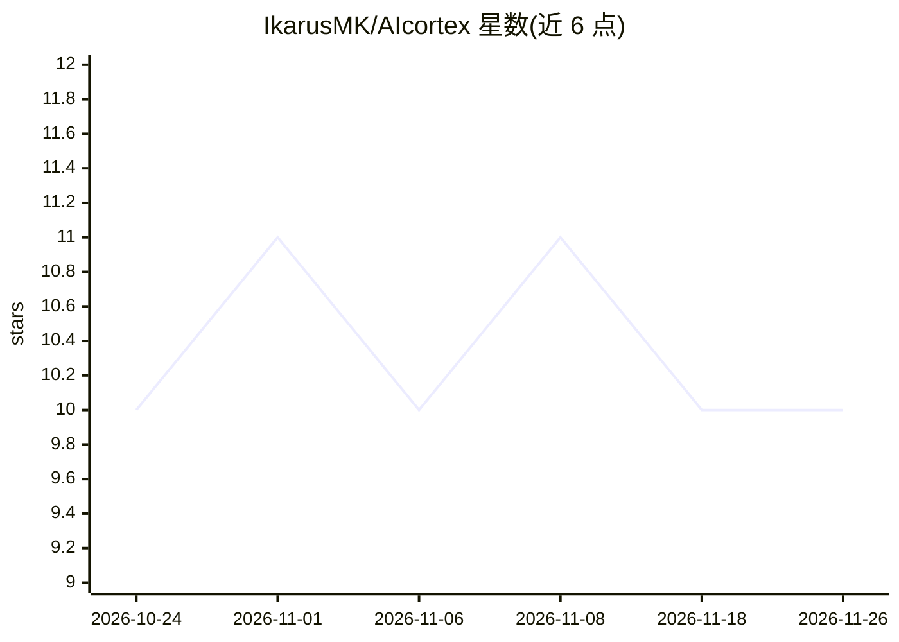

# IkarusMK/AIcortex

⭐ 10 · Python · Apache-2.0 · 推送 2026-11-19 · [GitHub](https://github.com/IkarusMK/AIcortex) · 个人维护

**给 NAS 上的 LLM 提供自托管记忆、技能与工具接入的 MCP 服务器**

以单个 Docker 容器运行的自托管 MCP 服务器，为 MCP 客户端（Claude、ChatGPT 或本地模型）提供持久化的个人上下文：类型化记忆与技能路由、加密密钥保管库、邮件/日历/设备等服务接入、cron 计划任务（到点唤醒 Claude Code 或调用 ChatGPT/API key/Ollama），并通过原生 REST API（自动生成 OpenAPI 3.1）供 n8n、LangChain 等非 MCP 客户端使用。支持 OIDC 登录、角色、按用户隔离的多租户，提供内置管理 WebUI。运行需 Docker、反向代理与公网可达的域名。

## 筛选速览

| 维度 | 判定 | 备注 |
|---|---|---|
| AI 角色 | `ai-ecosystem` | LLM/agent 周边工具 |
| 许可风险 | `permissive` | Apache-2.0 |
| 部署形态 | `self-host` | docker 或自建部署 |
| 模型依赖 | local-ok | 支持本地模型 |
| 硬件要求 | — | 无带数字的原话,不猜 |
| 安装摩擦 | `low` | 无编译、无系统依赖或容器化 |
| 成熟度 | — | 结构信号不足 |

## 能力要点

- 单容器自托管 MCP 服务器：记忆、技能、密钥、计划任务以数据形式添加，无需重新部署
- 原生 REST API + 自动生成 OpenAPI 3.1，非 MCP 客户端（n8n、LangChain、脚本）可接入同一大脑
- 加密密钥保管库：凭据仅服务器内部使用，不交给模型；SSRF 出口防护与 fail-closed 能力检查
- 跨 LLM 会话交接、多租户角色隔离与按用户 API key（默认拒绝、限速、哈希存储）

## 适用场景

- 在 NAS 上为 Claude/ChatGPT/本地模型挂载统一的个人记忆与技能
- 让计划任务定时唤醒 AI 执行晨报、周报等例程
- 通过 webhooks 与 IMAP/CalDAV/MQTT 等让 AI 读写自己的服务与设备
- 团队多用户场景下按角色共享同一个 AI 大脑并隔离各自数据

## 场景标签

`Agent 框架` `工作流自动化` `Agent 记忆` · 领域:Agent 开发

## 证据(README 行号)

> L30: AICortex is a self-hosted MCP server that turns your NAS into a **personal LLM connector**: a persistent "brain" yo
> L51: - A **native REST API**: every tool as `POST /api/v1/tools/<name>` with an **auto-generated OpenAPI 3.1** spec — pl
> L64: - **Runners** carry the jobs out — AICortex **wakes your Claude** (a Claude Code cloud task on your plan) with the 

## 星数曲线

2026-10-24 10 → 2026-11-26 10（+0）

---
*卡片 v1 · prompt 1.4 · 生成 2026-11-20 · 置信度 high · 依据 README sha `d43a27abe4d7` · [字段定义](../../DATASET.md)*
