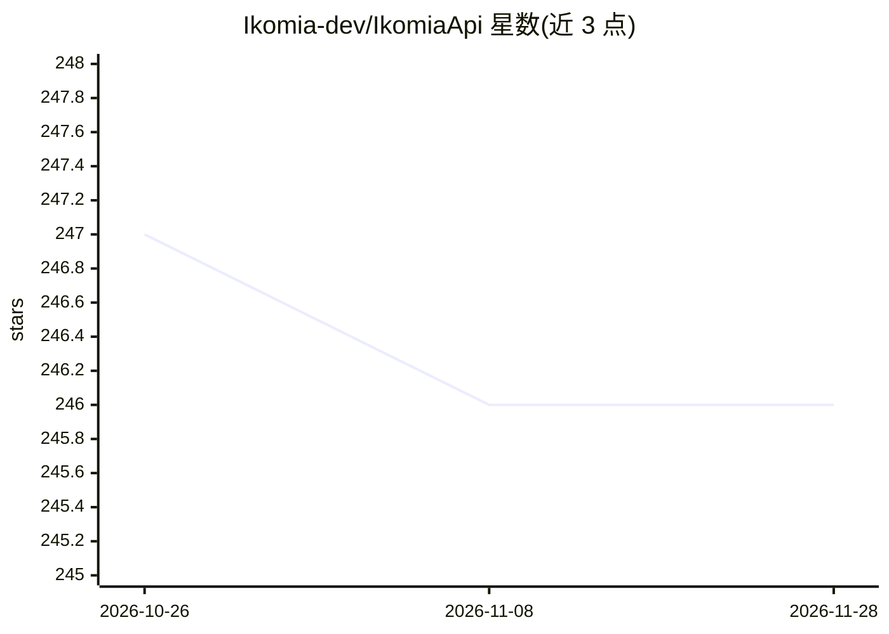

# Ikomia-dev/IkomiaApi

⭐ 246 · Python · Apache-2.0 · 推送 2026-11-26 · [GitHub](https://github.com/Ikomia-dev/IkomiaApi) · [官网](https://ikomia-dev.github.io/python-api-documentation/) · 组织维护

**数行代码部署计算机视觉算法的 Python 工作流库**

Ikomia API 是一个 Python 库，将研究算法封装为可部署任务：通过 Workflow 对象添加检测、姿态估计等任务并自动连接、运行于图像或 URL。算法来自 OpenCV、Detectron2、OpenMMLab、Hugging Face 等来源，通过 Ikomia HUB 分发，并提供 'ik' 自动补全辅助发现算法。工作流可导出分享、与 Ikomia STUDIO 集成；提供 Colab 教程与文档，Apache-2.0 许可。

## 筛选速览

| 维度 | 判定 | 备注 |
|---|---|---|
| AI 角色 | `ai-native` | 本体是模型或模型工具 |
| 许可风险 | `permissive` | Apache-2.0 |
| 部署形态 | `library` | 以包/库形式分发 |
| 模型依赖 | — | README 未给出锁定关系 |
| 硬件要求 | — | 无带数字的原话,不猜 |
| 安装摩擦 | `low` | 无编译、无系统依赖或容器化 |
| 成熟度 | — | 结构信号不足 |

## 能力要点

- Workflow 框架串联多算法并自动连接任务输入输出
- 聚合 OpenCV、Detectron2、OpenMMLab、Hugging Face 来源的算法
- 'ik' 自动补全系统辅助发现 Ikomia HUB 中的算法
- 工作流导出与分享，可与 Ikomia STUDIO 集成

## 适用场景

- 几行代码在图像上运行目标检测或姿态估计
- 把多个视觉算法组合成可复现的工作流
- 在数据集上训练并运行 YOLOv7 等检测模型

## 场景标签

`工作流自动化` `目标检测` `图像视频处理` · 领域:效率与自动化

## 证据(README 行号)

> L29: Welcome to Ikomia, where we transform intricate research algorithms into user-friendly, deployable solutions for co
> L60: pose_estimation = wf.add_task(name="infer_mmlab_pose_estimation", auto_connect=True)
> L33: - **Research Meets Reality**: We bridge the gap between cutting-edge research and real-world applications. With Iko

## 星数曲线

2026-10-26 247 → 2026-11-28 246（-1）

---
*卡片 v1 · prompt 1.4 · 生成 2026-11-26 · 置信度 high · 依据 README sha `6bf89045f643` · [字段定义](../../DATASET.md)*
