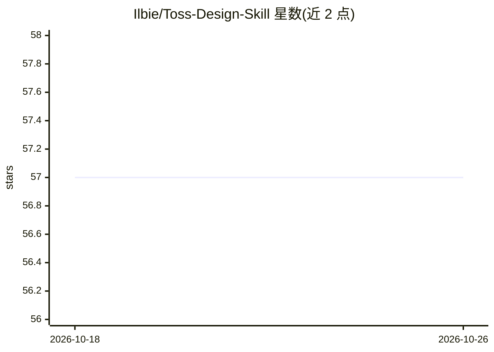

# Ilbie/Toss-Design-Skill

⭐ 57 · MIT · 推送 2026-06-25 · [GitHub](https://github.com/Ilbie/Toss-Design-Skill) · 个人维护

**参考 Toss Tech 设计文章的非官方 agent 技能包**

由个人维护的非官方技能包（SKILL.md），将 Toss Tech 设计文章中的产品思考、研究运营、内部工具、UX Writing、可访问性与品牌判断方式整理为 agent 可读取的参考内容，供 Claude Code、OpenCode、Codex 等 agent 环境通过 skills 目录使用。通过 npx skills add 或 git clone 手动安装。含基于文章的摘要参考文档，明确声明不替代原文、与 Toss 官方无关联，并禁止在生成结果中直接使用 Toss 品牌元素。

## 筛选速览

| 维度 | 判定 | 备注 |
|---|---|---|
| AI 角色 | `ai-ecosystem` | LLM/agent 周边工具 |
| 许可风险 | `permissive` | MIT |
| 部署形态 | `library` | 以包/库形式分发 |
| 模型依赖 | — | README 未给出锁定关系 |
| 硬件要求 | — | 无带数字的原话,不猜 |
| 安装摩擦 | `low` | 无编译、无系统依赖或容器化 |
| 成熟度 | — | 结构信号不足 |

## 能力要点

- SKILL.md 技能正文 + 基于 Toss Tech 设计文章的参考摘要
- 兼容 Claude Code / OpenCode / Codex 的通用 skills CLI 安装方式
- 明确非官方声明与品牌元素使用限制

## 适用场景

- 让 agent 参考 Toss 设计文章的思维方式做 UI/UX 设计
- 为设计类任务补充产品思考与 UX Writing 参考

## 场景标签

`提示工程` · 领域:Agent 开发

## 证据(README 行号)

> L60: - `SKILL.md` - 실제로 불러서 쓰는 스킬 본문
> L61: - `sources/toss-tech-design-summary.md` - Toss Tech 디자인 아티클을 바탕으로 정리한 참고 요약본
> L66: 원하는 환경의 skills 디렉터리에 이 저장소를 그대로 복사해 사용하면 됩니다.

## 星数曲线

2026-10-18 57 → 2026-10-26 57（+0）

---
*卡片 v1 · prompt 1.4 · 生成 2026-10-24 · 置信度 mid · 依据 README sha `7d85d1a52728` · [字段定义](../../DATASET.md)*
