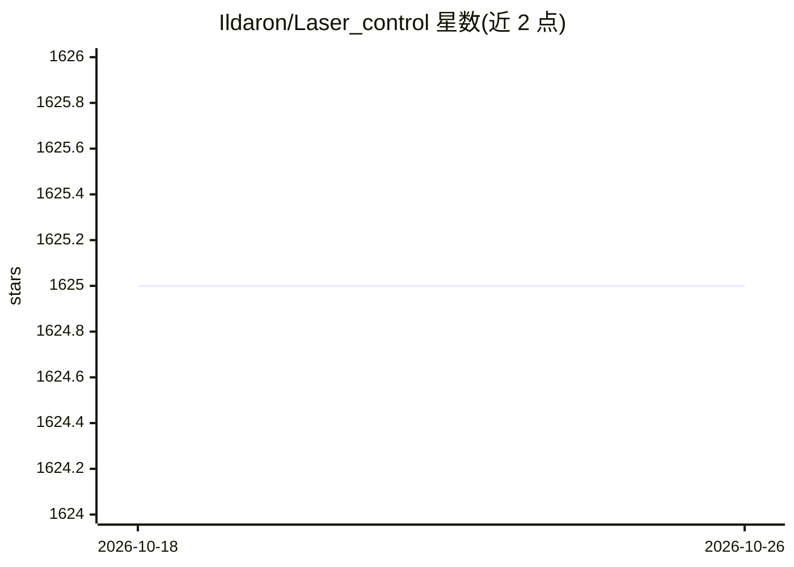

# Ildaron/Laser_control

⭐ 1,625 · Python · 推送 2026-03-30 · [GitHub](https://github.com/Ildaron/Laser_control) · 个人维护

**用激光+机器视觉定位消灭蚊子、害虫、杂草的硬件项目**

面向硬件实验者的开源激光装置项目：通过双目立体视觉测距（Z 坐标）与 Haar 级联/yolov4-tiny 深度学习检测（X/Y 坐标）定位蚊子、胡蜂、蟑螂、杂草等目标，计算检流计镜面偏转角，经 SPI/DAC mcp4922 驱动检流计控制激光指向。README 提供原理、尺寸、镜面行程标定说明，并给出 Jetson nano 上多种框架的 FPS 实测数据（tkDNN 达 30-35 FPS）。作者强烈警告高功率激光的致盲风险，建议仅用 1mW 激光笔做追踪实验，且不应在家使用。附两篇 arXiv/preprint 论文引用。

## 筛选速览

| 维度 | 判定 | 备注 |
|---|---|---|
| AI 角色 | `ai-native` | 本体是模型或模型工具 |
| 许可风险 | `none` | — |
| 部署形态 | `None` |  |
| 模型依赖 | — | README 未给出锁定关系 |
| 硬件要求 | — | 无带数字的原话,不猜 |
| 安装摩擦 | `low` | 无编译、无系统依赖或容器化 |
| 成熟度 | — | 结构信号不足 |

## 能力要点

- 双目立体视觉+深度学习（Haar/yolov4-tiny）实现三维目标定位
- SPI→DAC mcp4922→放大器→检流计镜面控制激光指向
- Jetson nano 上多框架 FPS 实测（Darknet/tkDNN/DeepStream 等）
- 明确安全警告与安全模块设计（人体检测、音频/热成像传感器）

## 适用场景

- 搭建用安全激光笔追踪运动目标的实验装置
- 研究嵌入式单板机上的实时目标检测与 FPS 优化
- 复现低成本双目立体视觉深度测量方案

## 场景标签

`目标检测` · 领域:感知与多模态

## 证据(README 行号)

> L31: To detect x,y coordinates initially we used Haar cascades in RaspberryPI after that yolov4-tiny in Jetson nano.
> L39: Single board computer to processes the digital signal from the camera and determines positioning to the object, and
> L61: At the expense of computer vision, the position of the object in the X, Y plane is determined - based on which its 

## 星数曲线

2026-10-18 1,625 → 2026-10-26 1,625（+0）

---
*卡片 v1 · prompt 1.4 · 生成 2026-10-21 · 置信度 high · 依据 README sha `3a3115bb8b28` · [字段定义](../../DATASET.md)*
