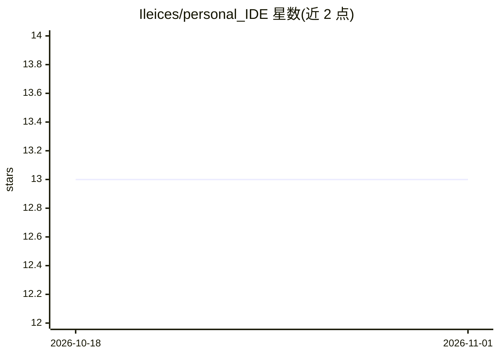

# Ileices/personal_IDE

⭐ 13 · Python · 推送 2026-09-22 · [GitHub](https://github.com/Ileices/personal_IDE) · [官网](https://github.com/Ileices/personal_IDE/discussions) · 个人维护

**开发者用的自改进 agentic IDE：agent 通过标签系统自动构建代码**

基于统一标签语言（devtag/plantag/buildtag）的 agent 驱动开发环境，agent 不直接读原始代码，而是通过确定性工具调用解析标签获取结构信息。系统分两层并发运行：Build Layer 执行构建循环（预编辑爬取、Skeptic 精炼、命令投票、Builder 执行、提交后验证）；Meta Layer 持续运行 Blame Crawler 归因、Gap Analysis 与 God Factory agent 的自我改进对话循环。前端为 React + Monaco 编辑器，后端 Fastify + SQLite，多 LLM 回退（经 GitHub PAT 接入 GitHub Models），含可选的 Python Nano Sea 分布式训练组件（296 个 nano）。部分规格特性标注为 coming_soon 尚未实现。

## 筛选速览

| 维度 | 判定 | 备注 |
|---|---|---|
| AI 角色 | `ai-native` | 本体是模型或模型工具 |
| 许可风险 | `permissive` | — |
| 部署形态 | `library` | 以包/库形式分发 |
| 模型依赖 | — | README 未给出锁定关系 |
| 硬件要求 | — | 无带数字的原话,不猜 |
| 安装摩擦 | `low` | 无编译、无系统依赖或容器化 |
| 成熟度 | — | 结构信号不足 |

## 能力要点

- devtag/plantag/buildtag 标签系统：标签图通过工具调用解析，不消耗上下文 token
- Build Layer 与 Meta Layer 双层并发，共享取证数据库与 agent 权限体系
- God Factory 对话界面：31 个工具、Suggested Jobs、代码健康度热图
- 多 LLM 回退与 Blame Crawler 按模型归因输出质量评分

## 适用场景

- 让 agent 在受标签协议约束的流程中自动完成代码修改与验证
- 持续监控代码库健康度并生成改进任务（Suggested Jobs）
- 通过对话界面驱动多 agent 构建管线

## 场景标签

`编码 Agent` `多智能体` · 领域:Agent 开发

## 证据(README 行号)

> L11: > An autonomous agentic IDE where agents never read raw code. Every structural
> L221: |**Chat Interface**|Conversational AI with 31 live tools wired to the system|

## 星数曲线

2026-10-18 13 → 2026-11-01 13（+0）

---
*卡片 v1 · prompt 1.4 · 生成 2026-10-31 · 置信度 mid · 依据 README sha `36b5705f122b` · [字段定义](../../DATASET.md)*
