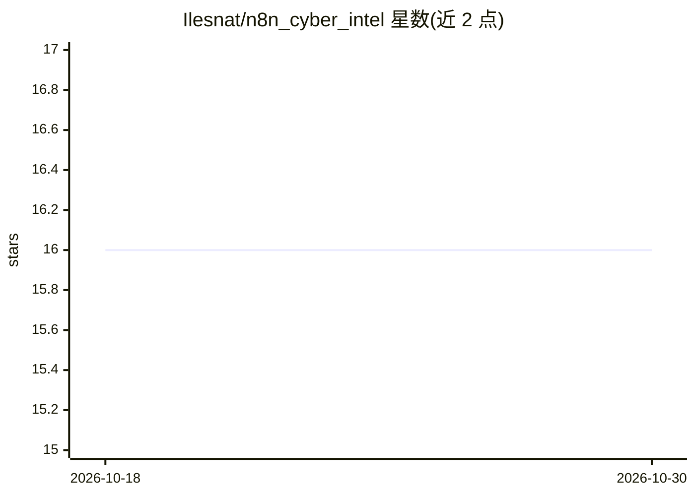

# Ilesnat/n8n_cyber_intel

⭐ 16 · 推送 2025-11-17 · [GitHub](https://github.com/Ilesnat/n8n_cyber_intel) · 个人维护

**n8n 工作流：聚合 RSS 并用 AI 生成每日威胁情报邮件摘要**

基于 n8n 构建的自动化工作流：定时触发后经 HTTP 节点抓取多个 RSS 源，解析为结构化条目，合并去重并过滤最近 72 小时内的文章（无近期条目时输出兜底项），随后由 AI 节点生成整体摘要、提取重点故事并去除低价值内容，最终通过邮件节点发送日报。面向使用 n8n 的安全运营人员。使用前需在 n8n 中导入 JSON、重新配置 AI 模型与 Gmail 凭据并调整 Cron 计划。

## 筛选速览

| 维度 | 判定 | 备注 |
|---|---|---|
| AI 角色 | `ai-native` | 本体是模型或模型工具 |
| 许可风险 | `none` | — |
| 部署形态 | `None` |  |
| 模型依赖 | — | README 未给出锁定关系 |
| 硬件要求 | — | 无带数字的原话,不猜 |
| 安装摩擦 | `low` | 无编译、无系统依赖或容器化 |
| 成熟度 | — | 结构信号不足 |

## 能力要点

- 多 RSS 源聚合、去重与 72 小时时间过滤
- AI 节点执行摘要、重点提取与降噪
- 定时触发自动发送邮件日报，无近期条目时输出兜底项

## 适用场景

- 每日自动收到网络安全资讯 AI 摘要邮件
- 把最新威胁情报纳入日常安全运营流程

## 场景标签

`工作流自动化` `网络安全` · 领域:效率与自动化

## 证据(README 行号)

> L3: This project is an **automated RSS aggregation and AI-generated cyber threat intel newsletter system** built using *
> L19: - Feeds the combined article list into an AI model.

## 星数曲线

2026-10-18 16 → 2026-10-30 16（+0）

---
*卡片 v1 · prompt 1.4 · 生成 2026-10-30 · 置信度 mid · 依据 README sha `4ce672570aa7` · [字段定义](../../DATASET.md)*
