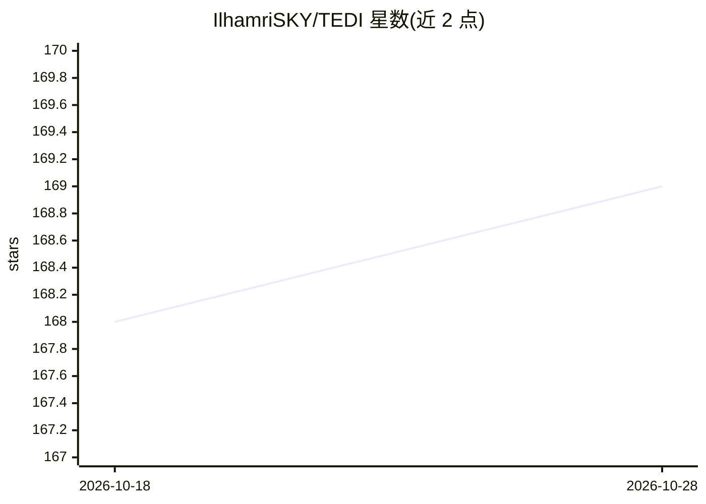

# IlhamriSKY/TEDI

⭐ 169 · TypeScript · Apache-2.0 · 推送 2026-10-26 · [GitHub](https://github.com/IlhamriSKY/TEDI) · [官网](https://tedi.ilhamriski.com) · 个人维护

**八合一开发者工作台桌面应用：终端/SSH/编辑器/API 客户端/Git 加 AI agent**

基于 Tauri 2（Rust 核心 + 单一 webview）的轻量桌面应用，把终端复用器、SSH/SFTP、SQL 浏览器、代码编辑器、AI agent、浏览器、API 客户端和 Git 集成到单窗口，宣称常驻占用接近终端而非 IDE。AI agent 支持 12 家服务商及 LM Studio/Ollama 等 OpenAI 兼容本地服务，密钥存于 OS 钥匙串，支持完全离线本地模型运行；浏览器扩展仅限 Windows。为 crynta/terax-ai 的 Apache-2.0 分支。

## 筛选速览

| 维度 | 判定 | 备注 |
|---|---|---|
| AI 角色 | `ai-enhanced` | 去掉 AI 部分产品仍成立 |
| 许可风险 | `permissive` | Apache-2.0 |
| 部署形态 | `desktop` | 安装包/桌面程序 |
| 模型依赖 | local-ok | 支持本地模型 |
| 硬件要求 | — | 无带数字的原话,不猜 |
| 安装摩擦 | `low` | 无编译、无系统依赖或容器化 |
| 成熟度 | — | 结构信号不足 |

## 能力要点

- 八功能单窗口：终端/SSH/SQL/编辑器/AI agent/浏览器/API 客户端/Git
- AI agent 支持 12 家云服务商及 LM Studio、Ollama、vLLM 等本地服务，可完全离线
- API 密钥存 OS keychain，不落盘；无遥测
- 扩展系统：运行时从 .zip 或 GitHub 安装，SQL 浏览器与 API 客户端也以扩展形式交付

## 适用场景

- 在一个窗口里完成终端、SSH、编辑、Git、API 调试等日常开发操作，减少切换
- 用自带密钥或本地模型驱动的 agent 做编码辅助与浏览器自动化
- 轻量替代多工具并开的开发环境

## 场景标签

`编码 Agent` · 领域:编码与开发

## 证据(README 行号)

> L13: **TEDI** (Terminal Director) folds eight tools you reach for every day (a terminal, SSH client, DB browser, editor,
> L23: |5|**AI-native agent**|Bring-your-own-key agent across twelve providers (OpenAI, Anthropic, Google, xAI, Cerebras, 

## 星数曲线

2026-10-18 168 → 2026-10-28 169（+1）

---
*卡片 v1 · prompt 1.4 · 生成 2026-10-22 · 置信度 mid · 依据 README sha `1a51a97f28af` · [字段定义](../../DATASET.md)*
