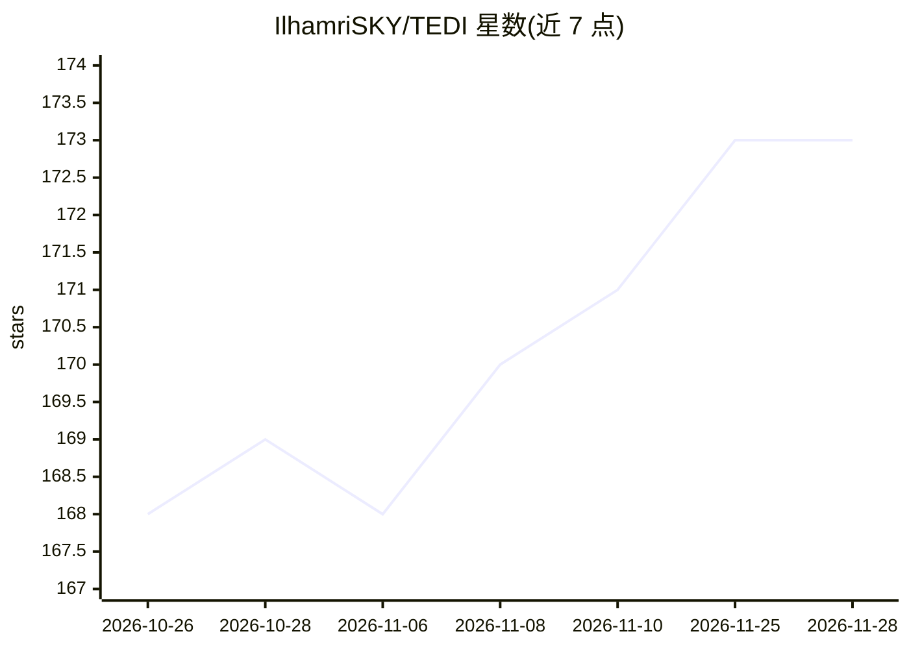

# IlhamriSKY/TEDI

⭐ 173 · TypeScript · Apache-2.0 · 推送 2026-11-11 · [GitHub](https://github.com/IlhamriSKY/TEDI) · [官网](https://tedi.ilhamriski.com) · 个人维护

**八合一开发者工作台：终端/SSH/编辑器/AI Agent 集于一个窗口**

基于 Tauri 2 的桌面应用，将八个日常工具合并到一个窗口：终端复用器、SSH/SFTP 客户端、SQL 浏览器、代码编辑器、AI Agent、内嵌浏览器、API 客户端与 Git 源码管理。UI 为单个系统 webview，无 Node 运行时与捆绑 Chromium，体积在 10 MB 量级；无遥测，API key 存入系统 keychain。AI 部分为自带 key 的 Agent，支持十二家云服务商与本地模型（LM Studio/Ollama/llama.cpp/vLLM 等兼容端点）、Plan mode、MCP、子 Agent 与经审批的工具调用。扩展（浏览器、SQL、API 客户端）运行时安装，二进制不内置。

## 筛选速览

| 维度 | 判定 | 备注 |
|---|---|---|
| AI 角色 | `ai-enhanced` | 去掉 AI 部分产品仍成立 |
| 许可风险 | `permissive` | Apache-2.0 |
| 部署形态 | `desktop` | 安装包/桌面程序 |
| 模型依赖 | local-ok | 支持本地模型 |
| 硬件要求 | — | 无带数字的原话,不猜 |
| 安装摩擦 | `low` | 无编译、无系统依赖或容器化 |
| 成熟度 | — | 结构信号不足 |

## 能力要点

- Bring-your-own-key Agent，覆盖 OpenAI/Anthropic/DeepSeek 等云服务商及本地 OpenAI 兼容端点
- Plan mode、MCP、十个子 Agent、语音输入与需审批的工具调用
- API key 经 keyring 存入系统钥匙串，支持完全离线跑本地模型
- 扩展系统：SQL 浏览器、浏览器、API 客户端均运行时安装，不增大体积

## 适用场景

- 在一个窗口里完成终端、SSH、Git 与代码编辑，减少窗口切换
- 接入自己的 API key 或本地模型进行 AI 编码辅助与内联补全
- 用 SSH 隧道访问堡垒机后的数据库并编辑远程文件
- 打包 zip/GitHub release 安装扩展以扩展面板与命令

## 场景标签

`编码 Agent` · 领域:编码与开发

## 证据(README 行号)

> L13: **TEDI** (Terminal Director) folds eight tools you reach for every day (a terminal, SSH client, DB browser, editor,
> L23: |5|**AI-native agent**|Bring-your-own-key agent across twelve providers (OpenAI, Anthropic, Google, xAI, Cerebras, 

## 星数曲线

2026-10-26 168 → 2026-11-28 173（+5）

---
*卡片 v1 · prompt 1.4 · 生成 2026-11-26 · 置信度 mid · 依据 README sha `18ad7d16231e` · [字段定义](../../DATASET.md)*
