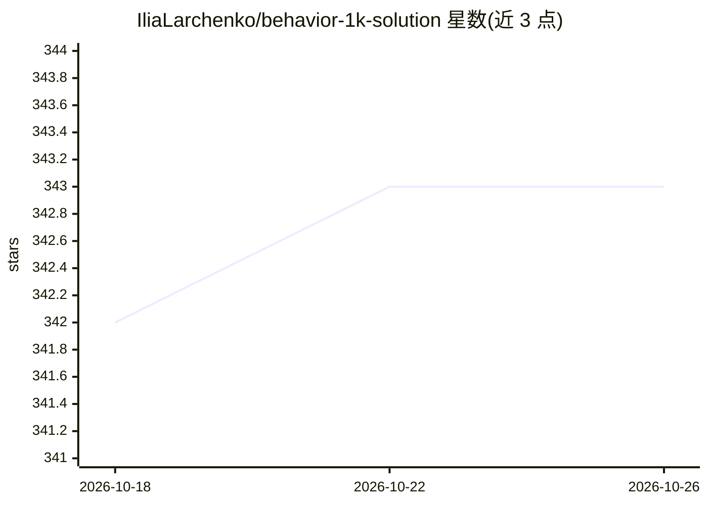

# IliaLarchenko/behavior-1k-solution

⭐ 343 · Python · Apache-2.0 · 推送 2026-01-24 · [GitHub](https://github.com/IliaLarchenko/behavior-1k-solution) · [官网](https://robot-learning-collective.github.io/winning-behavior-1k-challenge) · 组织维护

**2025 BEHAVIOR 挑战赛冠军方案：基于 Pi0.5 的机器人操作策略训练与评测代码**

为 BEHAVIOR-1K 仿真基准提供第一名的视觉-语言-动作（VLA）方案：在 openpi 之上改造 Pi0.5，用 50 个可训练任务嵌入替换语言模型、引入相关噪声 Flow Matching、System 2 阶段预测与软 inpainting 推理加速等。仓库提供安装脚本、数据准备、单/多 GPU（FSDP）训练、微调与策略服务器评测流程，并在 HuggingFace 发布 4 个按任务子集划分的检查点。限制：仅支持其竞赛改造版模型，需 BEHAVIOR-1K 仿真环境做评测。

## 筛选速览

| 维度 | 判定 | 备注 |
|---|---|---|
| AI 角色 | `ai-native` | 本体是模型或模型工具 |
| 许可风险 | `permissive` | Apache-2.0 |
| 部署形态 | `None` |  |
| 模型依赖 | — | README 未给出锁定关系 |
| 硬件要求 | — | 无带数字的原话,不猜 |
| 安装摩擦 | `low` | 无编译、无系统依赖或容器化 |
| 成熟度 | — | 结构信号不足 |

## 能力要点

- 以 50 个可训练任务嵌入替换语言模型，无需文本处理
- 多步 Flow Matching 与相关噪声采样等训练改动
- System 2 阶段预测（投票逻辑的阶段跟踪）作为辅助输出
- 提供 4 个任务子集划分的预训练检查点与多检查点推理服务

## 适用场景

- 复现或研究 2025 BEHAVIOR 挑战赛的获胜方法
- 在 BEHAVIOR-1K 数据集上训练/微调 VLA 机器人策略
- 研究任务嵌入替代语言输入的 VLA 架构改动

## 场景标签

`微调` · 领域:训练与推理

## 证据(README 行号)

> L5: This repository contains our winning solution for the 2025 BEHAVIOR Challenge, achieving a 26% success rate on both 
> L10: We use policy based on Pi0.5 and built on top of openpi repository.

## 星数曲线

2026-10-18 342 → 2026-10-26 343（+1）

---
*卡片 v1 · prompt 1.4 · 生成 2026-10-21 · 置信度 high · 依据 README sha `81a247f521ac` · [字段定义](../../DATASET.md)*
