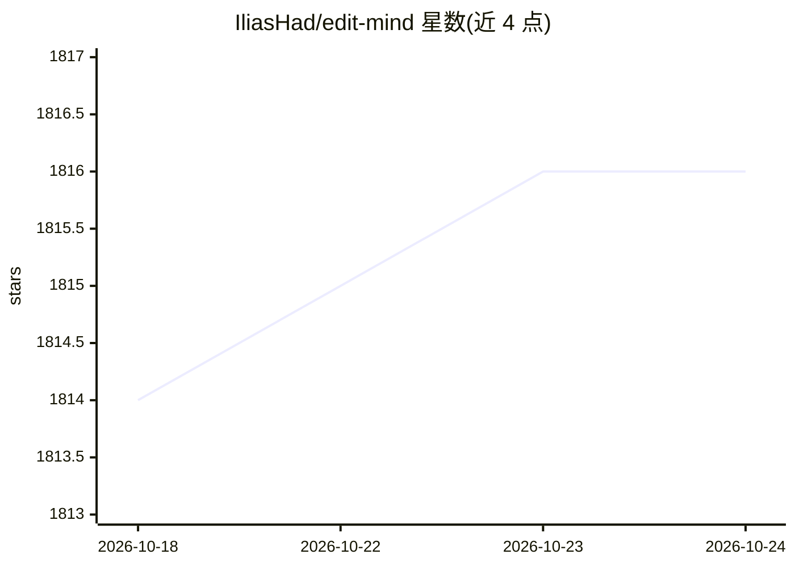

# IliasHad/edit-mind

⭐ 1,816 · TypeScript · NOASSERTION · 推送 2026-10-19 · [GitHub](https://github.com/IliasHad/edit-mind) · [官网](https://orcah.app) · 个人维护

**本地自托管视频知识库：索引视频并用自然语言检索**

面向希望本地管理视频素材的用户：后台服务监听视频文件夹并排队进行 AI 分析，提取人脸识别（DeepFace）、语音转录（Whisper）、物体与文本检测（YOLO）等元数据，经多模型嵌入后写入 ChromaDB，支持对视频或具体场景的自然语言语义搜索。通过 Docker Compose 部署，全部服务运行在容器中，也可用一键脚本安装；另有付费桌面应用。项目处于活跃开发期，尚未达到 v1.0，官方声明非生产就绪。

## 筛选速览

| 维度 | 判定 | 备注 |
|---|---|---|
| AI 角色 | `ai-native` | 本体是模型或模型工具 |
| 许可风险 | `none` | NOASSERTION |
| 部署形态 | `self-host` | docker 或自建部署 |
| 模型依赖 | — | README 未给出锁定关系 |
| 硬件要求 | — | 无带数字的原话,不猜 |
| 安装摩擦 | `low` | 无编译、无系统依赖或容器化 |
| 成熟度 | `idea` | |

## 能力要点

- 后台服务自动监听并处理新增视频文件
- 提取人脸识别、转录、物体与文本检测、场景分析等元数据
- 基于 ChromaDB 的自然语言语义搜索（可定位到具体场景）
- Docker Compose 全容器化部署，提供一键安装脚本

## 适用场景

- 把本地视频库做成可按内容语义搜索的知识库
- 通过口播内容、出现的人物或物体快速定位视频片段
- 在自有服务器上隐私安全地索引和分析视频

## 场景标签

`语义搜索` · 领域:知识与检索

## 证据(README 行号)

> L3: Edit Mind lets you index your videos **(including transcription, frame analysis, and multi-model embedding)**, and y
> L37: * **AI-Powered Video Analysis:** Extracts metadata like face recognition, transcription, object & text detection, s
> L38: * **Vector-Based Semantic Search:** Powerful natural language search capabilities on video content using ChromaDB.

## 星数曲线

2026-10-18 1,814 → 2026-10-24 1,816（+2）

---
*卡片 v1 · prompt 1.4 · 生成 2026-10-21 · 置信度 mid · 依据 README sha `061385d7b6ed` · [字段定义](../../DATASET.md)*
