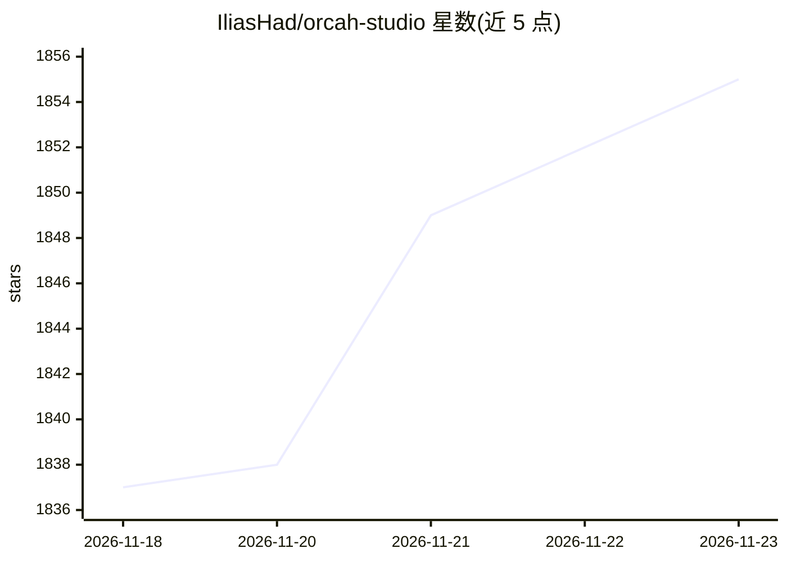

# IliasHad/orcah-studio

⭐ 1,855 · TypeScript · AGPL-3.0 · 推送 2026-11-18 · [GitHub](https://github.com/IliasHad/orcah-studio) · [官网](https://orcah.app) · 个人维护

**本地自托管视频知识库：自然语言检索视频内容**

自托管的本地视频知识库：后台服务监视视频文件夹，对入库视频做转录、人脸识别、物体与文字检测、场景分析，并用多模型嵌入写入 ChromaDB 向量库，随后支持以自然语言在视频或单个场景级别做语义检索。以 Docker Compose 部署的 Web 应用形式运行，ML 服务基于 Python/PyTorch/OpenAI Whisper，NLP 可选本地 Ollama 或 Gemini。README 声明项目处于活跃开发中，尚未 production-ready。

## 筛选速览

| 维度 | 判定 | 备注 |
|---|---|---|
| AI 角色 | `ai-native` | 本体是模型或模型工具 |
| 许可风险 | `viral` | AGPL-3.0 |
| 部署形态 | `self-host` | docker 或自建部署 |
| 模型依赖 | local-ok | 支持本地模型 |
| 硬件要求 | — | 无带数字的原话,不猜 |
| 安装摩擦 | `low` | 无编译、无系统依赖或容器化 |
| 成熟度 | `idea` | |

## 能力要点

- 转录+人脸识别+物体/文字检测+场景分析的多模态索引
- 基于 ChromaDB 的向量语义搜索，支持按口述内容/人脸/物体检索
- 本地运行，视频库保留在本机，仅将所选目录挂载给 Docker
- 提供 NVIDIA GPU 专用 docker-compose.cuda.yml

## 适用场景

- 在海量本地视频库中用自然语言找到某个片段
- 按人脸或出现的物体检索家庭/监控录像
- 在本地服务器上自托管隐私优先的视频检索服务

## 场景标签

`语义搜索` `语音识别` `人脸识别` `目标检测` · 领域:知识与检索

## 证据(README 行号)

> L3: **Orcah Studio** (formerly **Edit Mind**) is a self-hosted video knowledge base. It indexes your videos — including 
> L35: * **AI-Powered Video Analysis:** Extracts metadata like face recognition, transcription, object & text detection, s
> L36: * **Vector-Based Semantic Search:** Powerful natural language search capabilities on video content using ChromaDB.

## 星数曲线

2026-11-18 1,837 → 2026-11-23 1,855（+18）

---
*卡片 v1 · prompt 1.4 · 生成 2026-11-23 · 置信度 mid · 依据 README sha `dc4a56b4d901` · [字段定义](../../DATASET.md)*
