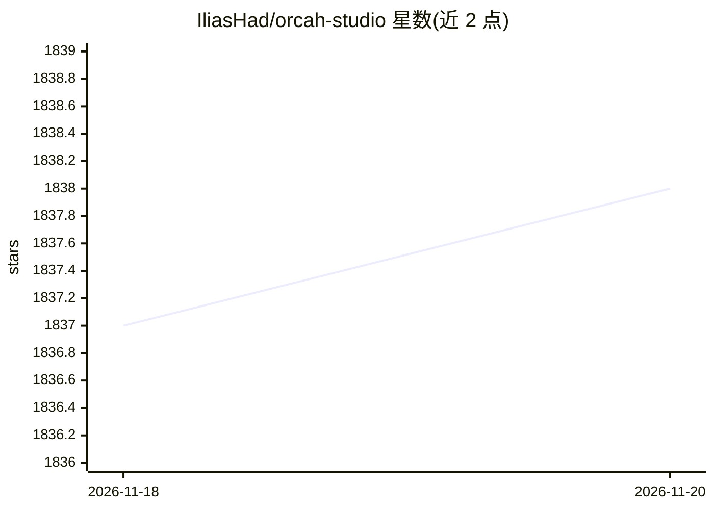

# IliasHad/orcah-studio

⭐ 1,838 · TypeScript · AGPL-3.0 · 推送 2026-11-18 · [GitHub](https://github.com/IliasHad/orcah-studio) · [官网](https://orcah.app) · 个人维护

**本地自托管视频知识库：索引视频并用自然语言搜索**

自托管的视频知识库应用（原 Edit Mind）：后台服务监视新视频文件并队列化处理，用 Whisper 转录、人脸识别、物体与文字检测、场景分析提取元数据，多模型嵌入后写入 ChromaDB，支持对视频或单个场景的自然语言语义搜索。全程本地运行，通过 Docker Compose 部署，NLP 可选本地 Ollama 或 Gemini。README 声明处于活跃开发、尚非生产就绪。另有付费原生 macOS 应用（orcah.app）。

## 筛选速览

| 维度 | 判定 | 备注 |
|---|---|---|
| AI 角色 | `ai-native` | 本体是模型或模型工具 |
| 许可风险 | `viral` | AGPL-3.0 |
| 部署形态 | `self-host` | docker 或自建部署 |
| 模型依赖 | local-ok | 支持本地模型 |
| 硬件要求 | — | 无带数字的原话,不猜 |
| 安装摩擦 | `low` | 无编译、无系统依赖或容器化 |
| 成熟度 | `idea` | |

## 能力要点

- 后台服务自动监视并索引新视频文件
- Whisper 转录、人脸识别、物体/文字检测等多模态元数据提取
- 基于 ChromaDB 的自然语言语义搜索（视频与场景级）
- Docker Compose 一键部署，提供 NVIDIA GPU 专用 compose 文件

## 适用场景

- 把本地视频库变成可搜索的知识库，按语音内容找片段
- 按出现的人物、物体、场景检索视频
- 在自有服务器上私密地管理视频素材

## 场景标签

`语义搜索` `人脸识别` `目标检测` · 领域:知识与检索

## 证据(README 行号)

> L3: **Orcah Studio** (formerly **Edit Mind**) is a self-hosted video knowledge base. It indexes your videos — including 
> L35: * **AI-Powered Video Analysis:** Extracts metadata like face recognition, transcription, object & text detection, s

## 星数曲线

2026-11-18 1,837 → 2026-11-20 1,838（+1）

---
*卡片 v1 · prompt 1.4 · 生成 2026-11-18 · 置信度 mid · 依据 README sha `01dd8040ab1a` · [字段定义](../../DATASET.md)*
