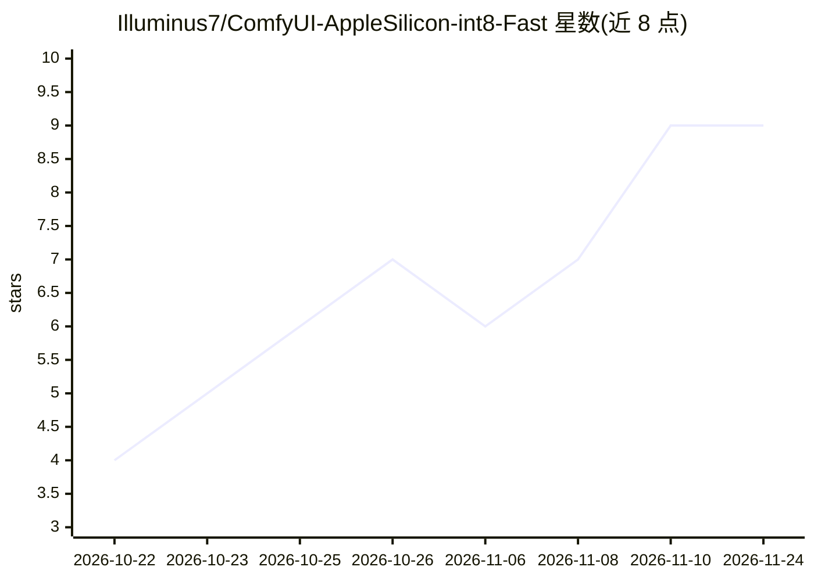

# Illuminus7/ComfyUI-AppleSilicon-int8-Fast

⭐ 9 · Python · MIT · 推送 2026-11-21 · [GitHub](https://github.com/Illuminus7/ComfyUI-AppleSilicon-int8-Fast) · 个人维护

**Apple Silicon 上 ComfyUI 的 int8 加速自定义节点包**

面向 Apple Silicon（M 系列芯片）的 ComfyUI 自定义节点包，基于 ComfyUI-AppleSilicon-FP8 项目改造。提供 int8 attention（默认开启，可经环境变量关闭）、基于 mmap 的更省内存模型加载与工作流切换时的显存释放机制。附带一个 Load LoRA (Bypass, Optional) 节点，为 Krea 2、MiniMax H3、LTX 2.5 提供 Hugging Face 上的示例工作流与模型文件清单。安装方式为复制到 custom_nodes 目录或 git clone。在 M5 Max 上调优，大模型（MiniMax H3 约 40 GB）在小内存芯片上放不下；以 ComfyUI v0.43 与 PyTorch 2.13–2.15 测试，未来更新可能破坏兼容。

## 筛选速览

| 维度 | 判定 | 备注 |
|---|---|---|
| AI 角色 | `ai-ecosystem` | LLM/agent 周边工具 |
| 许可风险 | `permissive` | MIT |
| 部署形态 | `None` |  |
| 模型依赖 | — | README 未给出锁定关系 |
| 硬件要求 | — | 无带数字的原话,不猜 |
| 安装摩擦 | `low` | 无编译、无系统依赖或容器化 |
| 成熟度 | — | 结构信号不足 |

## 能力要点

- int8 attention 默认开启，可经 INT8_ATTENTION 环境变量关闭
- mmap 加载与切换工作流时释放内存，减少 swap
- 附带可选 LoRA 槽位的 Bypass LoRA 加载节点
- 提供 Krea 2 / MiniMax H3 / LTX 2.5 的示例工作流与模型清单

## 适用场景

- 在 Apple Silicon Mac 上运行 ComfyUI 文生图/文生视频工作流并加速生成
- 在 48 GB 内存 Mac 上加载 MiniMax H3 这类大模型而不触发 swap
- 为工作流保留一个可不填的 LoRA 槽位

## 场景标签

`图像生成` `视频生成` · 领域:内容生成

## 证据(README 行号)

> L12: Fast int8 support in ComfyUI on Apple Silicon.
> L14: Copy this folder into `ComfyUI/custom_nodes/` and restart ComfyUI.

## 星数曲线

2026-10-22 4 → 2026-11-24 9（+5）

---
*卡片 v1 · prompt 1.4 · 生成 2026-11-20 · 置信度 mid · 依据 README sha `0d9fdff5a0b5` · [字段定义](../../DATASET.md)*
