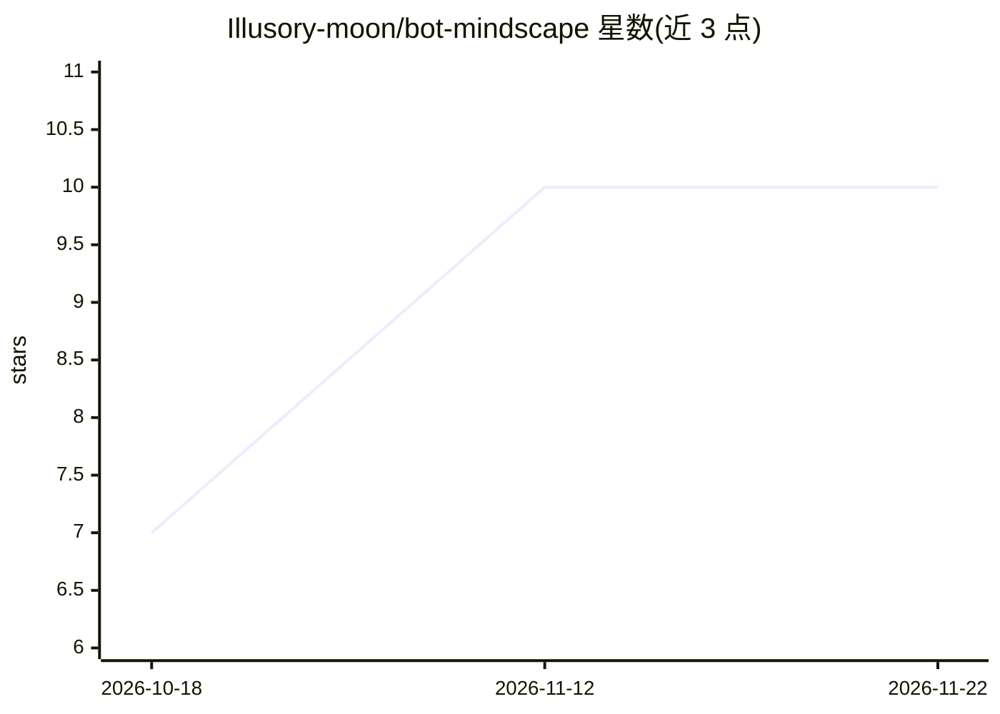

# Illusory-moon/bot-mindscape

⭐ 10 · Python · MIT · 推送 2026-11-20 · [GitHub](https://github.com/Illusory-moon/bot-mindscape) · 个人维护 · 中文 README

**为 AstrBot 群聊 bot 注入长期记忆与人设化表达的插件框架**

以 AstrBot 插件形式部署的增强框架，从六个层面处理聊天 bot 的常见缺陷：分层记忆（规矩/账本/风格/摘要/原文五层装配）、语气与表情包调度、API 报错拦截与空回复救援、定向性判定与自主冒泡、会话膨胀清理、尺寸观测。配置文件驱动，自带桌面版与网页版管理台（仅监听本机），构建为单文件插件后放入 AstrBot 插件目录即可使用；个人印象插件为独立可选组件。

## 筛选速览

| 维度 | 判定 | 备注 |
|---|---|---|
| AI 角色 | `ai-enhanced` | 去掉 AI 部分产品仍成立 |
| 许可风险 | `permissive` | MIT |
| 部署形态 | `library` | 以包/库形式分发 |
| 模型依赖 | — | README 未给出锁定关系 |
| 硬件要求 | — | 无带数字的原话,不猜 |
| 安装摩擦 | `low` | 无编译、无系统依赖或容器化 |
| 成熟度 | — | 结构信号不足 |

## 能力要点

- 五层记忆装配，清空历史后仍能答出三天前的具体事件
- 报错拦截与沉默令牌：服务器故障时不吐 API Error、可真沉默
- 时钟驱动的自主冒泡与定向性判定，不被 @ 也可主动开口
- 自带桌面/网页管理台，配置、图库、记忆可视化操作

## 适用场景

- 给 AstrBot 群聊 bot 加上跨会话的长期记忆
- 让角色扮演 bot 的语气和表情包贴合人设
- 避免 bot 在群里抢话或误回复不相关的消息
- 拦截报错信息防止破坏沉浸式 role-play

## 场景标签

`聊天机器人` `Agent 记忆` · 领域:Agent 开发

## 证据(README 行号)

> L37: - **装进 AstrBot**：把 `dist/mindscape/main.py` 放进插件目录再重启，详见 **部署指南**
> L55: |**① 认知** Cognition|在字数预算内装配五层记忆（规矩 → 账本 → 风格 → 摘要 → 原文），能不靠历史就答上具体的事|`memory` `recall` `notes` `learn`|
> L3: > **在认知、表达、沉浸、唤醒四个层面的通用增强框架** —— 治金鱼记忆、文字机器、机械出戏、不叫不动。

## 星数曲线

2026-10-18 7 → 2026-11-22 10（+3）

---
*卡片 v1 · prompt 1.4 · 生成 2026-11-20 · 置信度 high · 依据 README sha `c024e9a061b0` · [字段定义](../../DATASET.md)*
