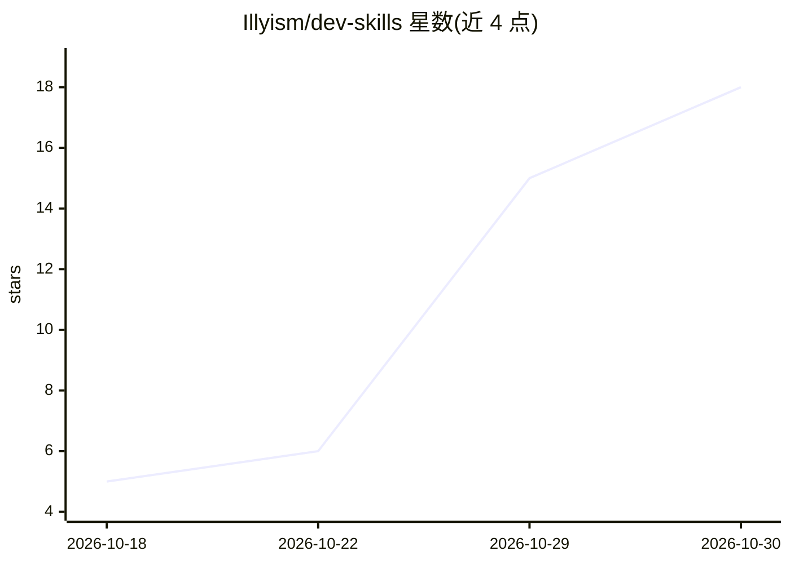

# Illyism/dev-skills

⭐ 18 · TypeScript · 推送 2026-10-15 · [GitHub](https://github.com/Illyism/dev-skills) · [官网](https://il.ly/skills) · 个人维护

**面向 AI agent 的开发者与产品技能合集（SKILL.md 格式）**

开源技能集合，提供 eval、benchmarking、cleanup、optimize、elon、extension-store-assets 六个技能，每个技能为遵循 Agent Skills 规范的单个 SKILL.md 文件，内容覆盖 AI 评测、性能基准、代码清理、Chrome 商店素材生成等开发与产品场景。兼容 Claude Code、Cursor、Codex 及任何读取 SKILL.md 的 agent，通过 npx skills add 命令按需安装，MIT 许可，由 Ilias Ism 维护。

## 筛选速览

| 维度 | 判定 | 备注 |
|---|---|---|
| AI 角色 | `ai-knowledge` | 知识聚合/清单类 |
| 许可风险 | `none` | — |
| 部署形态 | `library` | 以包/库形式分发 |
| 模型依赖 | — | README 未给出锁定关系 |
| 硬件要求 | — | 无带数字的原话,不猜 |
| 安装摩擦 | `low` | 无编译、无系统依赖或容器化 |
| 成熟度 | — | 结构信号不足 |

## 能力要点

- 6 个技能，覆盖代码与产品两类（eval/benchmarking/cleanup/optimize/elon/extension-store-assets）
- 单文件 SKILL.md，遵循 Agent Skills 规范
- 兼容 Claude Code、Cursor、Codex 及任何读取 SKILL.md 的 agent
- npx skills add 按技能粒度安装

## 适用场景

- 为 Claude Code / Cursor / Codex 添加 AI 评测与基准测试技能
- 让 agent 生成 Chrome 扩展商店图标与文案素材
- 用 agent 清理未使用的导出、变量与文件

## 场景标签

`提示工程` · 领域:Agent 开发

## 证据(README 行号)

> L3: Open-source developer and product skills for Claude Code, Cursor, Codex and any agent that reads `SKILL.md` files.
> L18: |Skill|Category|What it does|
> L20: |eval|Code|Minimal 1-file AI evals for prompts, models and production functions|

## 星数曲线

2026-10-18 5 → 2026-10-30 18（+13）

---
*卡片 v1 · prompt 1.4 · 生成 2026-10-30 · 置信度 high · 依据 README sha `d479ce790447` · [字段定义](../../DATASET.md)*
