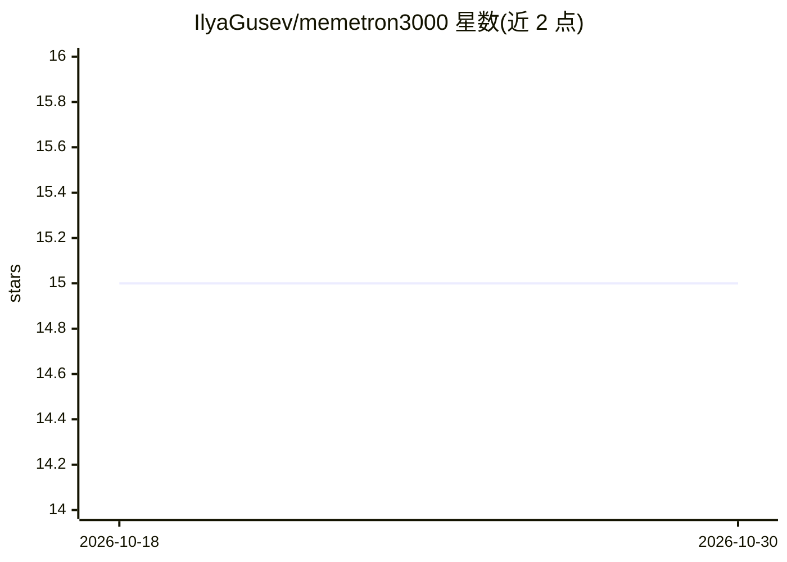

# IlyaGusev/memetron3000

⭐ 15 · Python · 推送 2026-08-19 · [GitHub](https://github.com/IlyaGusev/memetron3000) · [官网](https://ilyagusev.dev/memetron3000) · 个人维护

**俄语梗图生成器：用视觉 LLM 按模板生成梗图**

自托管 Web 服务：用户提交文本 prompt，系统从 20+ 俄语梗图模板中选取模板，经 Jinja2 渲染提示词后通过 OpenRouter 调用 Google Gemini 3 Pro Image 生成新梗图；配套异步任务队列、缩略图生成、SQLite 元数据存储、REST API 与分页画廊。需要 Python 3.11+ 与 OpenRouter API key，生成功能默认关闭需手动开启。由 IlyaGusev 以教育与研究用途提供。

## 筛选速览

| 维度 | 判定 | 备注 |
|---|---|---|
| AI 角色 | `ai-native` | 本体是模型或模型工具 |
| 许可风险 | `none` | — |
| 部署形态 | `library` | 以包/库形式分发 |
| 模型依赖 | locked-api |  |
| 硬件要求 | — | 无带数字的原话,不猜 |
| 安装摩擦 | `low` | 无编译、无系统依赖或容器化 |
| 成熟度 | — | 结构信号不足 |

## 能力要点

- 通过 OpenRouter 调用 Gemini 3 Pro Image 生成梗图
- 20+ 俄语梗图模板与 Jinja2 提示词渲染
- 异步任务队列与 REST API（生成/状态/画廊/健康检查）
- 生成结果存 SQLite 并自动生成缩略图

## 适用场景

- 自托管一个俄语梗图生成网站供社区使用
- 通过 REST API 程序化批量生成梗图
- 浏览历史生成结果并分页查看画廊

## 场景标签

`图像生成` · 领域:内容生成

## 证据(README 行号)

> L3: An automatic Russian meme generator powered by vision-capable language models. MEMETRON 3000 uses AI to generate con
> L7: - **AI-Powered Generation**: Uses Google's Gemini 3 Pro Image via OpenRouter to generate memes

## 星数曲线

2026-10-18 15 → 2026-10-30 15（+0）

---
*卡片 v1 · prompt 1.4 · 生成 2026-10-30 · 置信度 mid · 依据 README sha `a96d9e91d7fb` · [字段定义](../../DATASET.md)*
