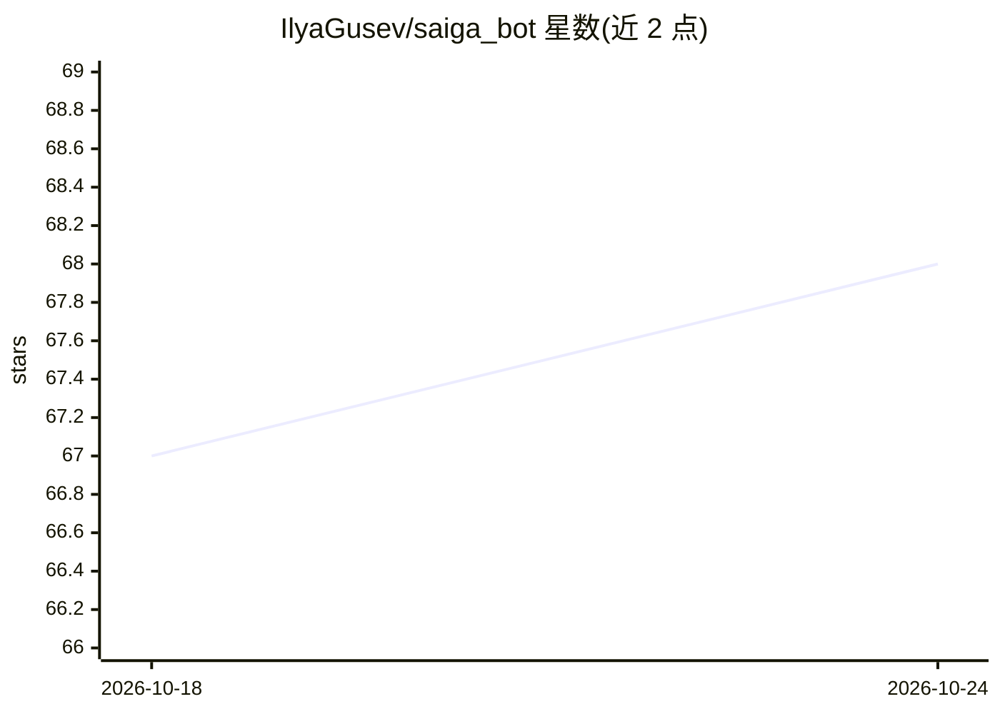

# IlyaGusev/saiga_bot

⭐ 68 · Python · Apache-2.0 · 推送 2026-08-19 · [GitHub](https://github.com/IlyaGusev/saiga_bot) · [官网](https://t.me/saiga_igusev_bot) · 个人维护

**对接多种语言模型的 Telegram 机器人**

通过 Telegram 平台与语言模型对话的机器人：支持任意数量兼容 OpenAI API 格式的模型端点，通过 providers.json 配置各模型 URL 与 token；支持系统提示词、生成参数与角色（characters）设定，可处理图片输入。安装方式为克隆仓库后用 uv 建虚拟环境、make install 安装依赖，配置 BotFather token 与管理员信息后以 make serve 运行，数据存于 SQLite，并含 YooKassa 支付配置项。

## 筛选速览

| 维度 | 判定 | 备注 |
|---|---|---|
| AI 角色 | `ai-native` | 本体是模型或模型工具 |
| 许可风险 | `permissive` | Apache-2.0 |
| 部署形态 | `None` |  |
| 模型依赖 | — | README 未给出锁定关系 |
| 硬件要求 | — | 无带数字的原话,不猜 |
| 安装摩擦 | `medium` | 含编译或系统依赖之一 |
| 成熟度 | — | 结构信号不足 |

## 能力要点

- 支持任意数量兼容 OpenAI API 格式的模型端点
- 支持系统提示词、生成参数与角色设定
- 支持图片处理能力
- 数据存储于 SQLite，含 Yookassa 支付配置项

## 适用场景

- 在 Telegram 中与多种语言模型对话
- 通过角色与系统提示词定制机器人行为
- 接入自有的 OpenAI 兼容推理端点

## 场景标签

`聊天机器人` · 领域:对话与助手

## 证据(README 行号)

> L5: This is a Telegram bot designed to interact with various language models. It offers support for system prompts and i
> L10: - Support for any number of language models (compatible with OpenAI API format)

## 星数曲线

2026-10-18 67 → 2026-10-24 68（+1）

---
*卡片 v1 · prompt 1.4 · 生成 2026-10-24 · 置信度 high · 依据 README sha `8f3aaf533922` · [字段定义](../../DATASET.md)*
