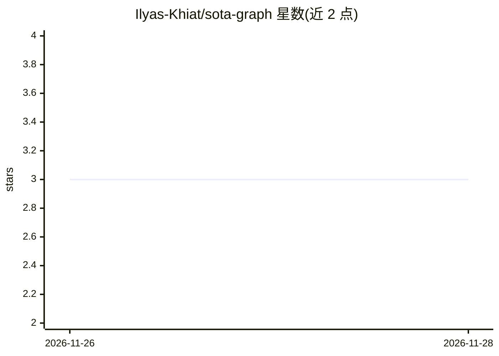

# Ilyas-Khiat/sota-graph

⭐ 3 · Rust · MIT · 推送 2026-11-12 · [GitHub](https://github.com/Ilyas-Khiat/sota-graph) · 个人维护

**把论文表格抽取为可溯源知识图谱的科研工具**

sota-graph 从 arXiv 论文抽取结果表格，构建记录 SOTA 排行榜与方法谱系的知识图谱：LLM 读取表格后仅返回行列映射（方法/数据集/指标/设置及出处句子），数值由代码从原单元格逐字读取并校验，无法核验的条目进入人工审查队列；每个数值链接到固定的 arXiv 表格单元格，排行榜由代码从 Neo4j 图谱计算。README 自述处于开发中阶段（Roadmap 中的 GraphRAG 查询与 PDF 通道尚未实现），在 8 篇未见论文的冻结抽取上精度 0.773、召回 0.574。

## 筛选速览

| 维度 | 判定 | 备注 |
|---|---|---|
| AI 角色 | `ai-native` | 本体是模型或模型工具 |
| 许可风险 | `permissive` | MIT |
| 部署形态 | `None` |  |
| 模型依赖 | — | README 未给出锁定关系 |
| 硬件要求 | — | 无带数字的原话,不猜 |
| 安装摩擦 | `low` | 无编译、无系统依赖或容器化 |
| 成熟度 | `idea` | |

## 能力要点

- LLM 只输出表格映射，数值由代码从单元格原文读取并逐项校验
- 每个数值链接到 pinned arXiv 版本的精确表格单元格定位符
- 自检 gold 集（985+902 条结果）与冻结 held-out 评测报告精度/召回
- 本体为 config 文件（ontology.toml），Neo4j schema 由其生成

## 适用场景

- 构建知识图谱补全领域（KGC）的可信 SOTA 排行榜
- 核查论文间转抄数值的冲突与口径不一致
- 按相同数据集/协议对方法做可比性分组对比

## 场景标签

`知识图谱` `科研工具` · 领域:知识与检索

## 证据(README 行号)

> L9: sota-graph turns research papers into a trustworthy, queryable knowledge graph
> L48: - **The LLM extracts facts; code computes comparisons.** The model never decides
> L129: The model reads one table at a time and returns a *mapping* (which rows are

## 星数曲线

2026-11-26 3 → 2026-11-28 3（+0）

---
*卡片 v1 · prompt 1.4 · 生成 2026-11-26 · 置信度 high · 依据 README sha `722102dce4e8` · [字段定义](../../DATASET.md)*
