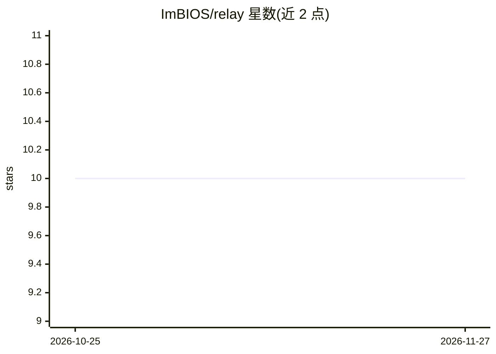

# ImBIOS/relay

⭐ 10 · TypeScript · MIT · 推送 2026-06-29 · [GitHub](https://github.com/ImBIOS/relay) · [官网](https://github.com/ImBIOS/relay) · 个人维护

**给 AI 编码 Agent 提供可热切换 LLM 提供商的本地代理 CLI**

一个管理并热切换 LLM 提供商的 CLI，内置本地 HTTP 代理：Agent 只需指向本地代理端点一次，即可在不重启会话的情况下切换 GitHub Copilot、OpenAI、Anthropic、Z.AI、MiniMax、DeepSeek、Groq、Ollama 等 14+ 提供商。核心机制包括 Anthropic/OpenAI 协议双向翻译、配额耗尽时的账号自动轮换、多账号管理与实时用量跟踪，并提供模型列表动态发现与用户自定义覆盖。面向使用 AI 编码工具（Claude Code、Codex CLI、Cline、Aider 等）的开发者。运行时依赖 Bun 1.2.0+。

## 筛选速览

| 维度 | 判定 | 备注 |
|---|---|---|
| AI 角色 | `ai-ecosystem` | LLM/agent 周边工具 |
| 许可风险 | `permissive` | MIT |
| 部署形态 | `library` | 以包/库形式分发 |
| 模型依赖 | local-ok | 支持本地模型 |
| 硬件要求 | — | 无带数字的原话,不猜 |
| 安装摩擦 | `low` | 无编译、无系统依赖或容器化 |
| 成熟度 | — | 结构信号不足 |

## 能力要点

- 本地 HTTP 代理：Agent 指向一次即可不重启热切换提供商
- Anthropic↔OpenAI 协议透明翻译，任意 Agent 对接任意提供商
- 账号自动轮换与多账号管理、实时配额监控
- 模型列表三级来源：用户覆盖/API 拉取缓存/内置静态

## 适用场景

- 在多个 LLM 提供商之间不重启会话地切换编码 Agent 后端
- 配额耗尽时自动轮换多账号继续使用
- 让只讲 Anthropic 协议的 Agent 使用 OpenAI 协议的提供商
- 跟踪各提供商账号的配额与用量

## 场景标签

`模型网关` · 领域:Agent 开发

## 证据(README 行号)

> L6: A CLI for managing and hot-switching LLM providers with a built-in HTTP proxy. Works with **any AI coding agent** (C
> L31: AI coding agents cache the model name and base URL at session start. Swapping providers mid-session requires a full
> L217: **Routing and translation**: The proxy routes requests based on the active account's provider. For providers that 

## 星数曲线

2026-10-25 10 → 2026-11-27 10（+0）

---
*卡片 v1 · prompt 1.4 · 生成 2026-11-20 · 置信度 high · 依据 README sha `e652f0ff1f93` · [字段定义](../../DATASET.md)*
