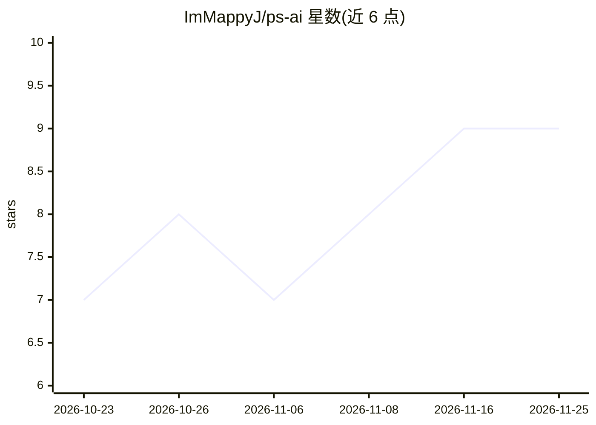

# ImMappyJ/ps-ai

⭐ 9 · TypeScript · GPL-3.0 · 推送 2026-11-04 · [GitHub](https://github.com/ImMappyJ/ps-ai) · [官网](https://www.itsmygo.cn) · 个人维护 · 中文 README

**Photoshop 插件：圈选区域调用多模型 AI 生成并回填图层**

基于 Adobe UXP 的 Photoshop 插件，支持在画布中圈选范围后调用本地 ComfyUI 或云平台后端生成 1-4 张候选图，比较后应用为带可编辑蒙版的新图层，原图层保留且可一次撤销。本地路线固定 Qwen 2.1 工作流，按模型扩展名选择 GGUF 或原生 Safetensors 加载；云端接入 Nano Banana（Gemini）、GPT Image 与百炼。需要 Windows Photoshop 2026/27.0+，通过 CCX 或 Portable 包安装，也可从源码构建加载。

## 筛选速览

| 维度 | 判定 | 备注 |
|---|---|---|
| AI 角色 | `ai-native` | 本体是模型或模型工具 |
| 许可风险 | `viral` | GPL-3.0 |
| 部署形态 | `desktop` | 安装包/桌面程序 |
| 模型依赖 | local-ok | 支持本地模型 |
| 硬件要求 | — | 无带数字的原话,不猜 |
| 安装摩擦 | `low` | 无编译、无系统依赖或容器化 |
| 成熟度 | `idea` | |

## 能力要点

- 圈选生成并应用为带蒙版的新图层，原图保留可撤销
- 支持本地 ComfyUI（GGUF/Safetensors）与 Gemini/OpenAI/百炼云后端
- 三种模式、12 个预设提示，支持保护区与参考图
- 支持 ICC 色彩管理、历史恢复与断线恢复任务

## 适用场景

- 局部换材质、移除杂物、换背景、改服装
- 为照片重新布光并输出光影图层
- 图像混合与合成并保留可编辑蒙版

## 场景标签

`图像生成` · 领域:内容生成

## 证据(README 行号)

> L5: **圈选要改的地方，把 AI 结果带回 Photoshop 图层。**
> L7: 局部换材质、移除杂物、换背景、改服装，或为画面重新布光。先比较候选，再应用为带可编辑蒙版的新图层；原图层保留，一次撤销可撤回一次应用。
> L34: |云端生成|Nano Banana（Gemini）、GPT Image（OpenAI Images）或百炼的 Key 与模型权限；自动中转需 Windows、Node.js 24+ 与宿主启动授权|

## 星数曲线

2026-10-23 7 → 2026-11-25 9（+2）

---
*卡片 v1 · prompt 1.4 · 生成 2026-11-20 · 置信度 high · 依据 README sha `9e4939dde571` · [字段定义](../../DATASET.md)*
