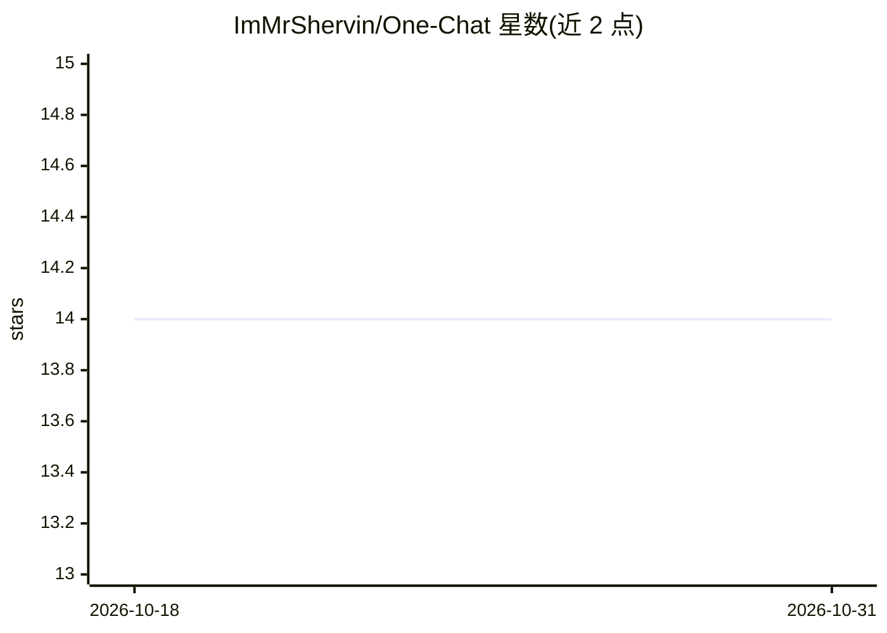

# ImMrShervin/One-Chat

⭐ 14 · HTML · 推送 2026-07-21 · [GitHub](https://github.com/ImMrShervin/One-Chat) · 个人维护 · 中文 README

**单文件 HTML 的 AI 聊天界面，连接本地与云端模型**

整个应用打包在一个 HTML 文件中，无安装、无构建、无后端，浏览器直接打开即可使用。支持 Ollama、LM Studio、OpenRouter、OpenAI、Groq、Together AI、Fireworks AI、DeepSeek、Google Gemini、Chrome AI、9Router 及任意 OpenAI 兼容 API 作为提供商。功能含流式响应、双模型对比、文件上传、历史搜索、Markdown 导出与备份恢复。聊天与设置存储于浏览器本地，请求直连所选提供商，不经中转服务器。

## 筛选速览

| 维度 | 判定 | 备注 |
|---|---|---|
| AI 角色 | `ai-ecosystem` | LLM/agent 周边工具 |
| 许可风险 | `none` | — |
| 部署形态 | `None` |  |
| 模型依赖 | local-ok | 支持本地模型 |
| 硬件要求 | — | 无带数字的原话,不猜 |
| 安装摩擦 | `low` | 无编译、无系统依赖或容器化 |
| 成熟度 | — | 结构信号不足 |

## 能力要点

- 单 HTML 文件、零依赖、无后端、无构建步骤
- 12 类提供商开箱支持，含任意 OpenAI 兼容 API
- 双模型对比模式与实时流式响应
- 数据与 API key 全部存于浏览器本地，直连提供商

## 适用场景

- 不想为每家模型服务商各装一个客户端，用单页统一聊天
- 在本地 Ollama/LM Studio 与云端模型之间快速切换对比
- 轻量场景下临时连接模型对话，无需部署任何服务

## 场景标签

`聊天机器人` · 领域:对话与助手

## 证据(README 行号)

> L5: One Chat is a lightweight AI chat interface designed to work with both local models and cloud AI services. Instead o
> L7: The entire application is contained in a single HTML file. There is nothing to install, no build process, and no bac
> L13: ## Supported Providers

## 星数曲线

2026-10-18 14 → 2026-10-31 14（+0）

---
*卡片 v1 · prompt 1.4 · 生成 2026-10-31 · 置信度 high · 依据 README sha `c2dfafeba4d8` · [字段定义](../../DATASET.md)*
