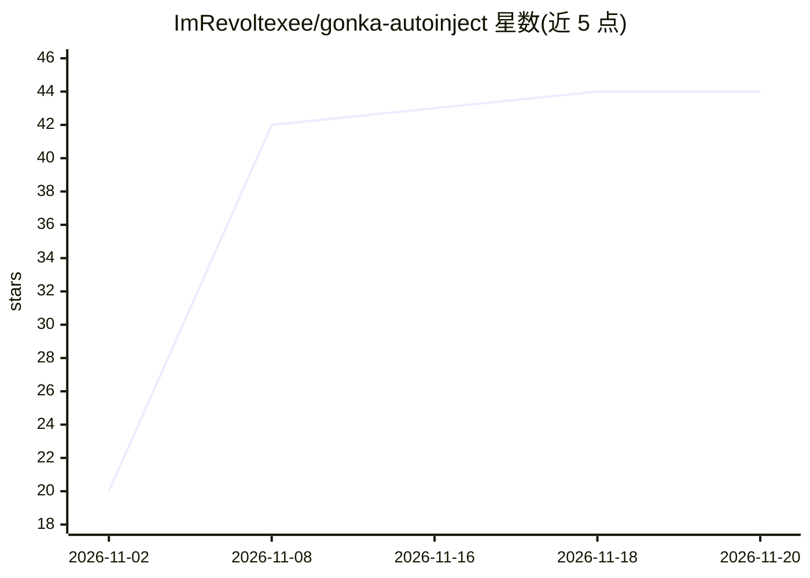

# ImRevoltexee/gonka-autoinject

⭐ 44 · Python · MIT · 推送 2026-11-06 · [GitHub](https://github.com/ImRevoltexee/gonka-autoinject) · 个人维护

**自动化批量注册 GonkaRouter 账号并把密钥注入 9Router 的守护工具**

Python 标准库实现（约 700 行，无第三方依赖）的账号注册流水线：farm.py 从一次性邮箱经 Turnstile 验证、邮件验证码、JWT 到生成 sk- 密钥；inject.py 批量导入密钥到 9Router 实例（作为 openai-compatible provider 节点）或逐个验证；watcher.py 常驻守护进程按轮询间隔注入新密钥。支持每账号独立代理轮换、幂等注入（只读路由 DB 判断已存在）、JSONL 日志，附 systemd 单元。需自备 Turnstile 求解服务监听 127.0.0.1:407。

## 筛选速览

| 维度 | 判定 | 备注 |
|---|---|---|
| AI 角色 | `ai-ecosystem` | LLM/agent 周边工具 |
| 许可风险 | `permissive` | MIT |
| 部署形态 | `library` | 以包/库形式分发 |
| 模型依赖 | — | README 未给出锁定关系 |
| 硬件要求 | — | 无带数字的原话,不猜 |
| 安装摩擦 | `low` | 无编译、无系统依赖或容器化 |
| 成熟度 | — | 结构信号不足 |

## 能力要点

- 完整注册流水线：一次性邮箱→Turnstile→邮件码→JWT→密钥
- 代理轮换（每账号一个出口 IP）与单次 token 处理
- 幂等注入：只读 9Router SQLite DB，重复运行不产生变更
- 密钥验证（探测 /v1/models）与 JSONL 可查询日志、systemd 单元

## 适用场景

- 批量获取 GonkaRouter 账号密钥并自动接入自己的 9Router
- 常驻守护模式持续把新密钥同步进路由
- 验证已有密钥可用性并生成 JSON 报告

## 场景标签

 · 领域:LLM API 基础设施/自动化

## 证据(README 行号)

> L9: Registration pipeline for **GonkaRouter** plus a daemon that pushes every key it
> L10: collects into a 9Router instance as a
> L18: |`inject.py`|bulk-imports the key file into 9Router, or verifies keys upstream|

## 星数曲线

2026-11-02 20 → 2026-11-20 44（+24）

---
*卡片 v1 · prompt 1.4 · 生成 2026-11-18 · 置信度 mid · 依据 README sha `6c48055522b4` · [字段定义](../../DATASET.md)*
