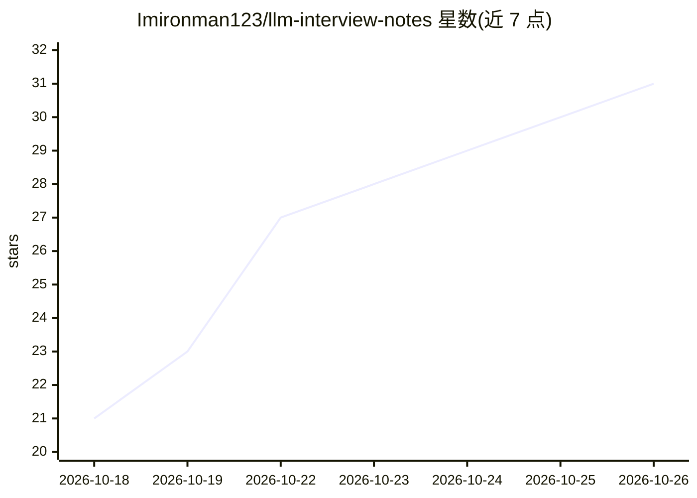

# Imironman123/llm-interview-notes

⭐ 31 · Python · 推送 2026-10-21 · [GitHub](https://github.com/Imironman123/llm-interview-notes) · 个人维护 · 中文 README

**大模型算法/应用/Infra 岗位面试资料合集：15 份文档、386 道题**

面向大模型算法研究、应用开发与 AI Infra 岗位的面试准备资料库。15 份 Markdown 文档共 386 道题、约 42 万字，覆盖 Transformer 八股、分布式训练、RLHF、推理优化、RAG、Agent、多模态、世界模型等方向，含字节 11 篇面经实录与 12 家大厂面经横向对比，附 30 篇论文精读清单。code/ 目录下提供 12 个可运行的手撕实现，均与 PyTorch 官方算子交叉验证。内容整理自 15 个公开仓库并逐一署名，面经细节声明与实际面试存在差异，仅供学习交流、禁止商用。

## 筛选速览

| 维度 | 判定 | 备注 |
|---|---|---|
| AI 角色 | `ai-knowledge` | 知识聚合/清单类 |
| 许可风险 | `none` | — |
| 部署形态 | `None` |  |
| 模型依赖 | — | README 未给出锁定关系 |
| 硬件要求 | — | 无带数字的原话,不猜 |
| 安装摩擦 | `medium` | 含编译或系统依赖之一 |
| 成熟度 | — | 结构信号不足 |

## 能力要点

- 15 份文档 · 386 道题，按知识体系而非来源仓库重组
- 字节 11 篇面经实录与 12 家大厂面经横向对比
- code/ 下 12 个可运行手撕实现，与 PyTorch 官方算子交叉验证
- Markdown 由 pandoc 从 docx 转换，GitHub 在线可读可全文搜索

## 适用场景

- 我准备大模型算法/应用/Infra 岗面试，需要系统化刷题与八股
- 我想了解字节等大厂的面试流程、轮次与考察偏好
- 我需要手撕 Attention、KV Cache、CUDA kernel 等代码练习素材

## 场景标签

`教程课程` · 领域:学习与行业

## 证据(README 行号)

> L3: 面向大模型 **算法研究 / 应用开发 / AI Infra** 岗位的系统化面试准备资料。
> L5: **15 份文档 · 386 道题 · 约 42 万字** —— 全部内容已转成 Markdown，可在 GitHub 上直接在线阅读和全文搜索，无需下载。

## 星数曲线

2026-10-18 21 → 2026-10-26 31（+10）

---
*卡片 v1 · prompt 1.4 · 生成 2026-10-26 · 置信度 high · 依据 README sha `9f4609514e71` · [字段定义](../../DATASET.md)*
