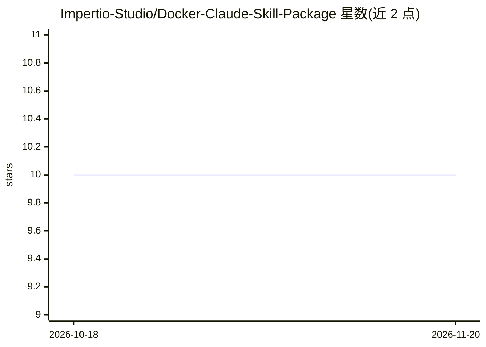

# Impertio-Studio/Docker-Claude-Skill-Package

⭐ 10 · MIT · 推送 2026-07-08 · [GitHub](https://github.com/Impertio-Studio/Docker-Claude-Skill-Package) · 组织维护

**面向 Claude 用户的 Docker 技能包：22 条确定性技能教模型写与调试容器配置**

为 Claude Code 提供的 22 条技能集合，覆盖 Dockerfile 编写与审查、多阶段构建、BuildKit、Compose v2 编排、容器安全加固与故障排查；每条技能经官方 Docker 文档核验，采用确定性 ALWAYS/NEVER 语言与决策树格式，单个 SKILL.md 限制在 500 行内并附 references/ 扩展内容。面向开发者、DevOps 工程师及使用开源 LLM 的团队。安装方式为配置 .claude/settings.json 或 git clone 后引用。MIT 许可，要求 Docker Engine 24+ 与 Compose v2。

## 筛选速览

| 维度 | 判定 | 备注 |
|---|---|---|
| AI 角色 | `ai-knowledge` | 知识聚合/清单类 |
| 许可风险 | `permissive` | MIT |
| 部署形态 | `self-host` | docker 或自建部署 |
| 模型依赖 | — | README 未给出锁定关系 |
| 硬件要求 | — | 无带数字的原话,不猜 |
| 安装摩擦 | `low` | 无编译、无系统依赖或容器化 |
| 成熟度 | — | 结构信号不足 |

## 能力要点

- 22 条经官方文档核验的 Docker/Compose 技能，按 core/syntax/impl/errors/agents 五类组织
- 确定性 ALWAYS/NEVER 语言与决策树格式，声明无幻觉 API
- 所有 Dockerfile 示例可构建，Compose 文件通过 docker compose config 校验
- 附 7 阶段研究先行的开发方法论与完整文档（INDEX/REQUIREMENTS/DECISIONS 等）

## 适用场景

- 让 Claude 为项目生成符合生产规范的 Dockerfile 与 Compose 文件
- 审查和调试容器构建失败、运行时错误与网络问题
- 团队统一容器配置规范与安全加固实践
- 为能力较弱的模型提供结构化 Docker 知识

## 场景标签

`代码生成` `代码审查` · 领域:编码与开发

## 证据(README 行号)

> L15: A curated collection of **22 deterministic skills** that teach Claude how to write, review, and debug Docker config
> L19: - **Developers** who want Claude to write production-grade Dockerfiles and Compose files
> L22: - **Open-source LLM users** who need structured Docker knowledge for less capable models

## 星数曲线

2026-10-18 10 → 2026-11-20 10（+0）

---
*卡片 v1 · prompt 1.4 · 生成 2026-11-20 · 置信度 mid · 依据 README sha `e82f54a4dcb0` · [字段定义](../../DATASET.md)*
