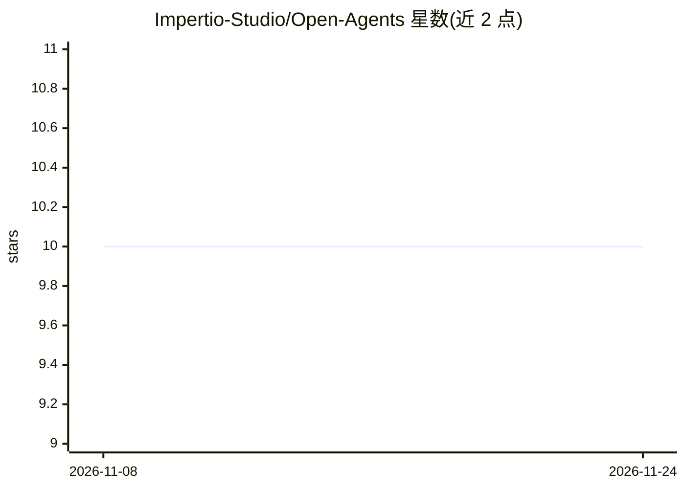

# Impertio-Studio/Open-Agents

⭐ 10 · TypeScript · Apache-2.0 · 推送 2026-09-15 · [GitHub](https://github.com/Impertio-Studio/Open-Agents) · [官网](https://github.com/OpenAEC-Foundation/Open-Agents) · 组织维护

**为 Claude Code 用户并行编排多个 AI agent 的 CLI 工具**

基于 Claude Code 订阅的多 agent 编排 CLI：通过 tmux 在本地并行启动多个 agent，提供 run/status/watch/pipeline/delegate 等 21+ 条命令，支持 Planner→Workers→Combiner 流水线、agent 间消息传递、最多 6 层嵌套生成，并附带 TUI 仪表盘与 React Web UI。内置 1612+ 个覆盖 112 类别的 agent 模板与 150+ 技能。依赖 Python>=3.10、tmux 与 Claude Code CLI（需有效订阅），Windows 仅支持 WSL2。

## 筛选速览

| 维度 | 判定 | 备注 |
|---|---|---|
| AI 角色 | `ai-ecosystem` | LLM/agent 周边工具 |
| 许可风险 | `permissive` | Apache-2.0 |
| 部署形态 | `library` | 以包/库形式分发 |
| 模型依赖 | local-ok | 支持本地模型 |
| 硬件要求 | — | 无带数字的原话,不猜 |
| 安装摩擦 | `low` | 无编译、无系统依赖或容器化 |
| 成熟度 | — | 结构信号不足 |

## 能力要点

- 通过 tmux 并行生成数百个 agent 并支持嵌套至 6 层
- Planner→并行 Workers→Combiner 的流水线编排
- 三种接口：CLI、Textual TUI 仪表盘、React Web UI
- 支持 Claude Opus/Sonnet/Haiku 与本地 Ollama 模型

## 适用场景

- 在多个终端会话中并行分配编码、测试、代码审查任务
- 用流水线把一个需求自动拆解为子任务并汇总结果
- 复用 112 个类别下的现成 agent 模板避免从零写 prompt

## 场景标签

`Agent 框架` `多智能体` `编码 Agent` · 领域:Agent 开发

## 证据(README 行号)

> L17: **Multi-agent orchestrator for Claude Code.** Spawn and coordinate hundreds of AI agents in parallel via a single C
> L44: |🔌 **MCP + Agent Messaging**|Integrate with any MCP client; inter-agent DMs|

## 星数曲线

2026-11-08 10 → 2026-11-24 10（+0）

---
*卡片 v1 · prompt 1.4 · 生成 2026-11-20 · 置信度 mid · 依据 README sha `0d77821d7d52` · [字段定义](../../DATASET.md)*
