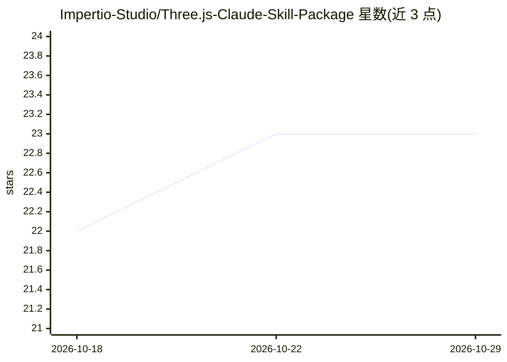

# Impertio-Studio/Three.js-Claude-Skill-Package

⭐ 23 · MIT · 推送 2026-07-08 · [GitHub](https://github.com/Impertio-Studio/Three.js-Claude-Skill-Package) · [官网](https://threejs.org/) · 组织维护

**给 Claude Code 用的 Three.js 开发技能包（24 个 SKILL.md）**

面向 Claude Code 的技能包，收录 24 个覆盖 Three.js r160+、React Three Fiber、Drei、WebGPU、物理引擎、IFC/BIM 等领域的 SKILL.md 技能文件，按核心、语法、实现、调试、编排五类组织。每个技能使用确定性的 ALWAYS/NEVER 表述以保证代码生成一致性，均少于 500 行且可独立使用，附带 methods/examples/anti-patterns 参考文件。通过 git clone 或 submodule 添加到 Claude Code 项目后按目录引用安装。

## 筛选速览

| 维度 | 判定 | 备注 |
|---|---|---|
| AI 角色 | `ai-knowledge` | 知识聚合/清单类 |
| 许可风险 | `permissive` | MIT |
| 部署形态 | `None` |  |
| 模型依赖 | locked-api |  |
| 硬件要求 | — | 无带数字的原话,不猜 |
| 安装摩擦 | `low` | 无编译、无系统依赖或容器化 |
| 成熟度 | — | 结构信号不足 |

## 能力要点

- 24 个技能覆盖 Three.js r160+、R3F、Drei、WebGPU、IFC 等技术
- 确定性 ALWAYS/NEVER 表述，每技能 <500 行（平均 338 行）
- 每个技能附 methods.md/examples.md/anti-patterns.md 参考文件
- 另提供 15 个跨技术 AEC 集成伴生技能（IFC↔Three.js、BIM↔GIS 坐标等）

## 适用场景

- 让 Claude Code 按 Three.js 最佳实践生成 3D Web 代码
- 调试 Three.js 渲染与性能问题（黑屏、内存泄漏、draw call）
- 构建 IFC/BIM Web 查看器与跨技术 AEC 集成方案

## 场景标签

`代码生成` `提示工程` · 领域:Agent 开发

## 证据(README 行号)

> L5: > 24 deterministic skills for Three.js 3D web development with Claude Code.
> L11: A comprehensive skill package that gives Claude deep knowledge of Three.js r160+, React Three Fiber, Drei, WebGPU, 

## 星数曲线

2026-10-18 22 → 2026-10-29 23（+1）

---
*卡片 v1 · prompt 1.4 · 生成 2026-10-27 · 置信度 high · 依据 README sha `90da64b1af6a` · [字段定义](../../DATASET.md)*
