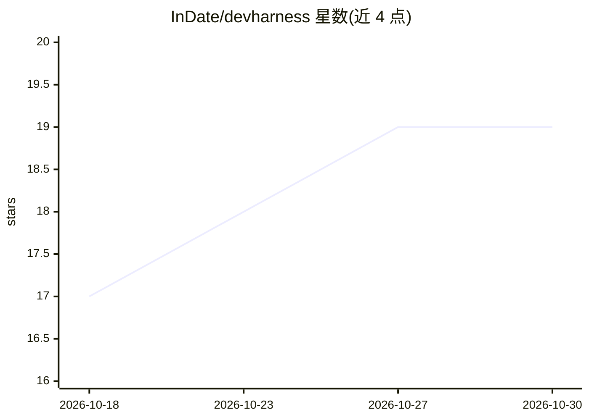

# InDate/devharness

⭐ 19 · TypeScript · MIT · 推送 2026-10-29 · [GitHub](https://github.com/InDate/devharness) · 个人维护

**让 AI 助手通过 Chrome DevTools Protocol 直接调试 Web 应用的 MCP 服务器**

MCP server，通过 Chrome DevTools Protocol 驱动 Chrome 与 Node.js：为 AI 代理提供独立 Chrome 窗口以打开应用、点击填表，读取浏览器控制台错误与 dev server 日志，支持断点/单步/变量检查、网络与存储检查、页面死链/死按钮检测。操作步骤编号并可保存为 sequence 重放，可导出为 Playwright/Puppeteer 测试；agent 无法自行标记 issue 已修复，需人工确认。需本机安装 Chrome 与 Node.js 18+，以 Claude Code 插件或 npx 运行。

## 筛选速览

| 维度 | 判定 | 备注 |
|---|---|---|
| AI 角色 | `ai-ecosystem` | LLM/agent 周边工具 |
| 许可风险 | `permissive` | MIT |
| 部署形态 | `self-host` | docker 或自建部署 |
| 模型依赖 | locked-api |  |
| 硬件要求 | — | 无带数字的原话,不猜 |
| 安装摩擦 | `low` | 无编译、无系统依赖或容器化 |
| 成熟度 | — | 结构信号不足 |

## 能力要点

- 代理在独立 Chrome 配置文件中操作应用并读取控制台错误与服务器日志
- Chrome 与 Node.js 双端断点调试，source map 支持在 TypeScript 行设断点
- 操作序列可保存重放并导出为 Playwright/Puppeteer 测试
- 多 agent 各自驱动同一 Chrome 的独立标签页

## 适用场景

- 让 AI 代理代替我打开应用复现并验证 bug 修复
- 代理自动检查页面的死按钮、死链接与布局问题
- 记录可复现步骤并在修复后重放验证

## 场景标签

`浏览器自动化` · 领域:效率与自动化

## 证据(README 行号)

> L109: devharness is an MCP server that drives Chrome
> L13: devharness gives the agent its own Chrome window. It opens your app, clicks and

## 星数曲线

2026-10-18 17 → 2026-10-30 19（+2）

---
*卡片 v1 · prompt 1.4 · 生成 2026-10-29 · 置信度 mid · 依据 README sha `590b2981ea7c` · [字段定义](../../DATASET.md)*
