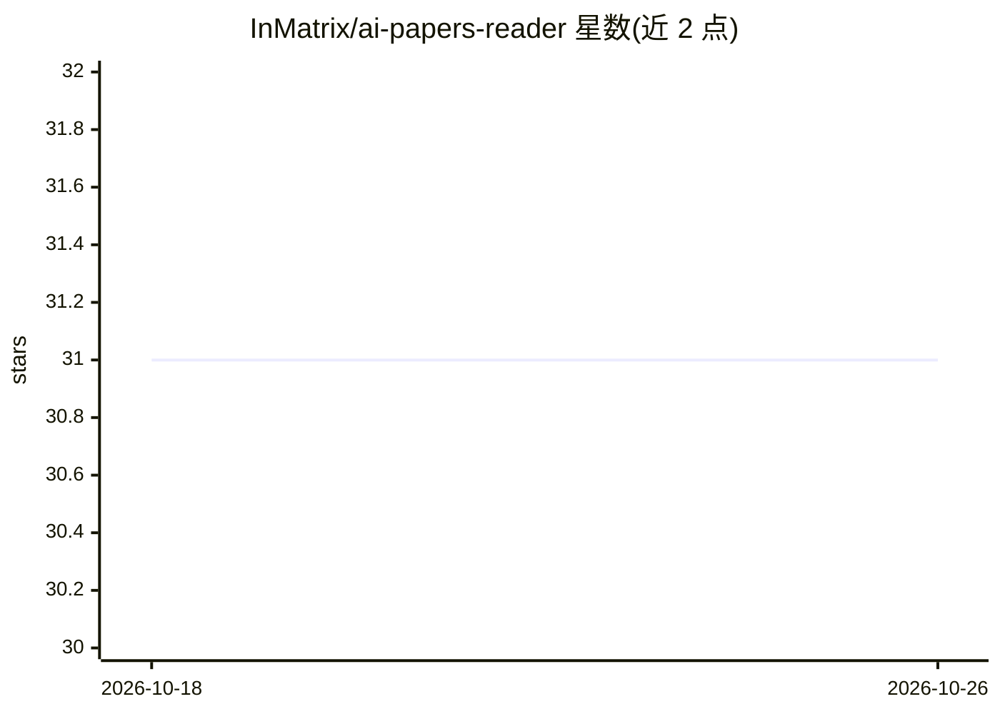

# InMatrix/ai-papers-reader

⭐ 31 · Python · MIT · 推送 2026-10-23 · [GitHub](https://github.com/InMatrix/ai-papers-reader) · [官网](https://ai-papers-reader.taodong.net/) · 个人维护

**生成每周 AI 论文个性化摘要的自动化 agent**

从 Hugging Face Daily Papers API 获取最新 AI 论文元数据，由可配置的 LLM（Claude/Gemini/DeepSeek 三选一）按用户在 prompt 模板中定制的主题筛选论文并生成摘要，形成每周 digest。流程通过 GitHub Actions 每周五自动运行，结果以 markdown 保存并通过 Netlify 部署为静态网站。用户通过 fork 仓库、编辑 prompt 与 config.yaml 定制行为；本地可用 pip 安装依赖后运行 CLI 脚本。PDF 处理有 15 MiB 上限与截断策略，DeepSeek 本地抽取文本故不支持无文本层的扫描版 PDF。

## 筛选速览

| 维度 | 判定 | 备注 |
|---|---|---|
| AI 角色 | `ai-native` | 本体是模型或模型工具 |
| 许可风险 | `permissive` | MIT |
| 部署形态 | `library` | 以包/库形式分发 |
| 模型依赖 | locked-api |  |
| 硬件要求 | — | 无带数字的原话,不猜 |
| 安装摩擦 | `low` | 无编译、无系统依赖或容器化 |
| 成熟度 | — | 结构信号不足 |

## 能力要点

- 按 prompt 中自定义主题筛选并摘要每周 AI 论文
- 支持 Claude/Gemini/DeepSeek 三个 LLM 供应商切换
- GitHub Actions 每周五定时运行，Netlify 自动部署静态站点
- PDF 处理含 15 MiB 上限与按 References 截断的分页策略

## 适用场景

- 我想每周收到符合自己研究方向主题的 AI 论文摘要
- 我fork仓库定制自己的论文筛选主题并自动发布成网站
- 我需要在多个 LLM 供应商间切换以生成论文摘要

## 场景标签

`科研工具` · 领域:学习与行业

## 证据(README 行号)

> L2: AI Papers Reader is an AI agent that brings you weekly digests of latest AI papers, customizable to topics you care 
> L11: * Google Gemini, DeepSeek, or Claude: The selected LLM processes paper metadata, identifies papers relevant to the 
> L12: * Github Actions: A workflow runs automatically on Fridays to retrieve the latest paper metadata and use the AI mod

## 星数曲线

2026-10-18 31 → 2026-10-26 31（+0）

---
*卡片 v1 · prompt 1.4 · 生成 2026-10-26 · 置信度 high · 依据 README sha `221e2d91c291` · [字段定义](../../DATASET.md)*
