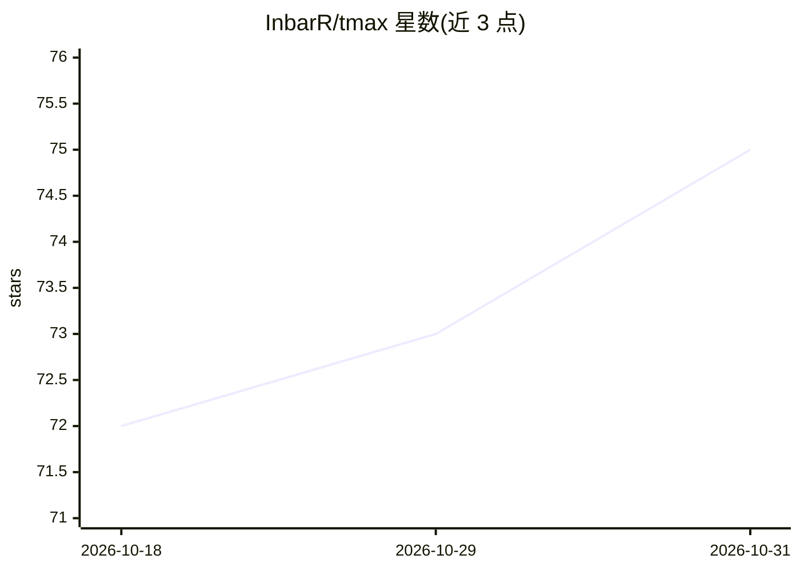

# InbarR/tmax

⭐ 75 · TypeScript · 推送 2026-10-30 · [GitHub](https://github.com/InbarR/tmax) · [官网](https://inbarr.github.io/tmax/) · 个人维护

**带 AI 会话监控的跨平台多终端平铺式终端应用**

基于 Electron、React、TypeScript 与 xterm.js 构建的跨平台（Windows/macOS/Linux）多终端应用，提供二叉树平铺布局、浮动面板、多工作区与网格视图。AI 相关功能包括：实时监控 GitHub Copilot 与 Claude Code 会话的 AI Sessions 面板（状态、摘要、分支、消息计数）、会话恢复、跨会话提示词搜索、只读对话记录面板、提示词编辑器与原生通知。另含内置任务板（Backlog）、文件浏览器、Git worktrees 面板、diff 审查、WSL 集成与完整的键盘驱动工作流。供运行多个终端与 AI 编码 agent 的开发者使用。

## 筛选速览

| 维度 | 判定 | 备注 |
|---|---|---|
| AI 角色 | `ai-enhanced` | 去掉 AI 部分产品仍成立 |
| 许可风险 | `none` | — |
| 部署形态 | `desktop` | 安装包/桌面程序 |
| 模型依赖 | — | README 未给出锁定关系 |
| 硬件要求 | — | 无带数字的原话,不猜 |
| 安装摩擦 | `medium` | 含编译或系统依赖之一 |
| 成熟度 | — | 结构信号不足 |

## 能力要点

- 实时监控 GitHub Copilot 与 Claude Code 会话并一键恢复
- 平铺布局（类 tmux 二叉树）+ 浮动面板 + 网格视图
- 跨会话提示词搜索与只读对话记录面板
- 内置多项目任务板、文件浏览器与 WSL 集成

## 适用场景

- 在多个终端中并行运行 AI 编码 agent 并统一监控状态
- 用平铺与浮动布局管理大量终端会话
- 跨项目查看任务板并跟踪 AI 会话产出
- 在 WSL 发行版中发现并恢复 AI 会话

## 场景标签

 · 领域:开发者工具/终端

## 证据(README 行号)

> L5:  Get the max out of your terminal. A powerful cross-platform multi-terminal app with tiling layouts, floating panels
> L51: **AI Sessions Panel**
> L52: - Monitor GitHub Copilot and Claude Code sessions in real-time (`Ctrl+Shift+C`)

## 星数曲线

2026-10-18 72 → 2026-10-31 75（+3）

---
*卡片 v1 · prompt 1.4 · 生成 2026-10-24 · 置信度 mid · 依据 README sha `b47e7c816a9a` · [字段定义](../../DATASET.md)*
