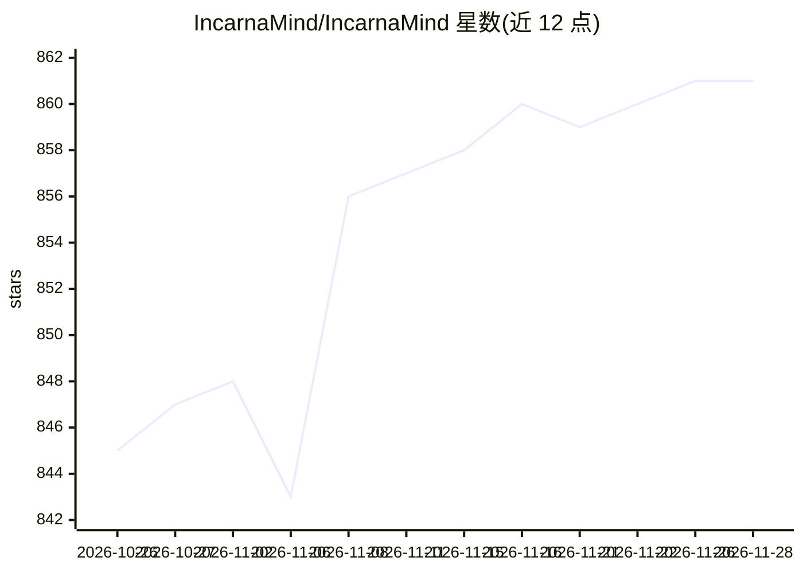

# IncarnaMind/IncarnaMind

⭐ 861 · TypeScript · Apache-2.0 · 推送 2026-11-27 · [GitHub](https://github.com/IncarnaMind/IncarnaMind) · 个人维护 · 中文 README

**让 AI 写出的内容逐句对照你的文件核验的桌面应用**

面向 macOS/Windows/Linux 的开源桌面应用，把用户文件集中在 Library 中排序与检索；接入 Claude Code 等 agent 或内置助手生成 Note，并对其逐句对照源文件核验，仅标出需人工查看的句子并给出对应页码；表格数字以代码在本机重算并展示过程。另提供本地会议转写、Word 编辑导出（支持八种引注格式脚注）、Zotero/BibTeX 等参考文献导入。模型可来自 ChatGPT 订阅、自有 API key 或 Ollama 本地模型，配合 Ollama 可完全离线。需注意核验无法发现文件本身的内容错误，也可能漏检语气义务变化。

## 筛选速览

| 维度 | 判定 | 备注 |
|---|---|---|
| AI 角色 | `ai-native` | 本体是模型或模型工具 |
| 许可风险 | `permissive` | Apache-2.0 |
| 部署形态 | `desktop` | 安装包/桌面程序 |
| 模型依赖 | local-ok | 支持本地模型 |
| 硬件要求 | — | 无带数字的原话,不猜 |
| 安装摩擦 | `low` | 无编译、无系统依赖或容器化 |
| 成熟度 | — | 结构信号不足 |

## 能力要点

- 逐句核验：仅标记需查看的句子并一键打开决定性页面
- 表格数字在本机以代码重算并展示计算过程
- 支持 Claude Code 等 agent 接入，也可用 ChatGPT 计划、自有 key 或 Ollama 本地模型
- Word 原样保留未改动部分并支持 tracked changes 导出

## 适用场景

- 让 AI 基于我的合同/财报写备忘录，并逐句核对是否有出处
- 在本地离线环境中对保密文件做带引注的问答
- 会议实时转写并生成标注发言人出处的纪要
- 编辑并导出 Word 文件而不破坏未改动部分

## 场景标签

`AI 助手` `文档问答` `语音识别` · 领域:对话与助手

## 证据(README 行号)

> L5:  The artifact layer for any agent: what your AI writes, checked against your files.
> L57: |**Check**|Check a Note, or a PDF, Word file, deck or workbook someone sent you, against your files, sentence by se
> L64: Works fully offline with Ollama: nothing leaves your computer.

## 星数曲线

2026-10-26 845 → 2026-11-28 861（+16）

---
*卡片 v1 · prompt 1.4 · 生成 2026-11-27 · 置信度 mid · 依据 README sha `1f08607a6ab4` · [字段定义](../../DATASET.md)*
