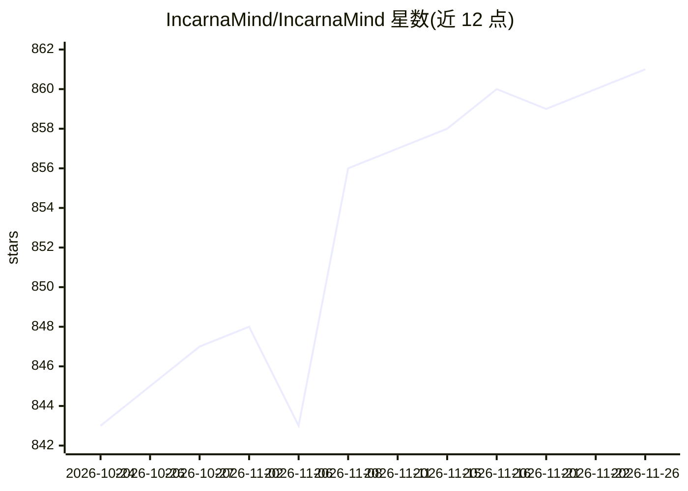

# IncarnaMind/IncarnaMind

⭐ 861 · TypeScript · Apache-2.0 · 推送 2026-11-25 · [GitHub](https://github.com/IncarnaMind/IncarnaMind) · 个人维护 · 中文 README

**桌面应用：核对 AI 代理所写内容与你的本地文件并逐句标注出处**

面向 macOS、Windows 与 Linux 的开源桌面应用，为 AI 代理产出的文本提供核对层：代理（如 Claude Code）写入的每句内容逐句比对用户本地文件，标注是否被来源支持，并定位到原文页码；图表数字在本地重算并展示过程。内置文件库管理 PDF/Word/PPT/Excel，支持本地会议转写、Word 导出与脚注引用、检索 OpenAlex/arXiv/PubMed 及 Zotero 参考文献导入。模型可通过 ChatGPT 套餐、自有 API key 或经 Ollama 的本地模型接入，无需注册账号。当前为未签名的预发布测试构建，公开 alpha 计划于 2027 年初开启。

## 筛选速览

| 维度 | 判定 | 备注 |
|---|---|---|
| AI 角色 | `ai-native` | 本体是模型或模型工具 |
| 许可风险 | `permissive` | Apache-2.0 |
| 部署形态 | `desktop` | 安装包/桌面程序 |
| 模型依赖 | local-ok | 支持本地模型 |
| 硬件要求 | — | 无带数字的原话,不猜 |
| 安装摩擦 | `low` | 无编译、无系统依赖或容器化 |
| 成熟度 | `idea` | |

## 能力要点

- 逐句核对代理写入内容与本地文件，标注支持状态并一键跳转原页
- 整表数字由本地代码重算并展示计算过程
- 可完全离线运行（经 Ollama 本地模型），文件不离开本机
- 支持 MCP 服务器与 SKILL.md 技能接入

## 适用场景

- 核对 AI 代理撰写的备忘录或报告是否与原始文件一致
- 在本地文件库上做带页码引用的问答
- 会议实时转写并生成标注发言人出处的会议纪要
- 编辑并导出保持原格式、可含修订记录的 Word 文件

## 场景标签

`AI 助手` `文档问答` `科研工具` `语音识别` · 领域:对话与助手

## 证据(README 行号)

> L5:  The artifact layer for any agent: what your AI writes, checked against your files.
> L57: |**Check**|Check a Note, or a PDF, Word file, deck or workbook someone sent you, against your files, sentence by se
> L64: Works fully offline with Ollama: nothing leaves your computer.

## 星数曲线

2026-10-24 843 → 2026-11-26 861（+18）

---
*卡片 v1 · prompt 1.4 · 生成 2026-11-24 · 置信度 high · 依据 README sha `5ad8167e56e5` · [字段定义](../../DATASET.md)*
