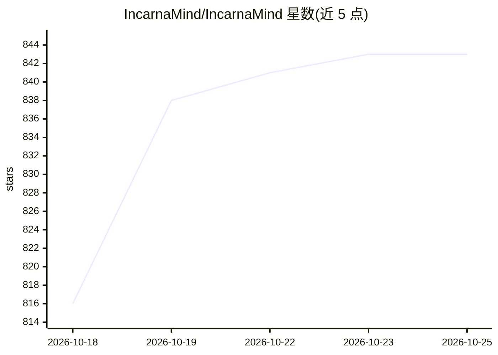

# IncarnaMind/IncarnaMind

⭐ 843 · TypeScript · Apache-2.0 · 推送 2026-10-24 · [GitHub](https://github.com/IncarnaMind/IncarnaMind) · 个人维护 · 中文 README

**本地优先的桌面 AI 写作与文档问答应用，引用逐句核验**

面向 macOS/Windows/Linux 的开源桌面应用（Apache-2.0）：在笔记（Mind）中写作并用 AI 就自己的文档（PDF、Word、PPT、Excel 等）提问；每个回答带页码引用并核验引文是否存在，草稿可逐句按文档判定 supported/unsupported/contradicted。模型可用 ChatGPT/Claude/Copilot 订阅登录或自有 API key，也可经 Ollama 用本地模型离线回答。支持会议转写、Zotero 导入、MCP Connectors 与 Skills。尚未发布安装包，需 Node.js 24+ 从源码运行；2026 年由 Python CLI 重写而来。

## 筛选速览

| 维度 | 判定 | 备注 |
|---|---|---|
| AI 角色 | `ai-native` | 本体是模型或模型工具 |
| 许可风险 | `permissive` | Apache-2.0 |
| 部署形态 | `desktop` | 安装包/桌面程序 |
| 模型依赖 | local-ok | 支持本地模型 |
| 硬件要求 | — | 无带数字的原话,不猜 |
| 安装摩擦 | `low` | 无编译、无系统依赖或容器化 |
| 成熟度 | `idea` | |

## 能力要点

- 每条回答的引用逐条核验到 PDF 页面
- 草稿逐句按自有文档判定支持/未支持/相矛盾
- 支持 ChatGPT/Claude/Copilot 订阅登录或自有 key，Ollama 本地模型可离线
- 读取本地文件不动原件，MCP Connectors 与 Skills 运行前需确认

## 适用场景

- 对大量 PDF/文献做问答与综述，核验每个引用的出处
- 起草合同或报告时逐句检查是否有文档依据
- 会议录音转写并作为可引用的文档保存

## 场景标签

`文档问答` `AI 写作` `科研工具` · 领域:内容生成

## 证据(README 行号)

> L22: **IncarnaMind** is a free, open-source desktop app for macOS, Windows and Linux where you write with AI and ask que
> L81: - **Is it an alternative to NotebookLM (now Gemini Notebook)?** Yes. IncarnaMind runs on your computer and reads yo

## 星数曲线

2026-10-18 816 → 2026-10-25 843（+27）

---
*卡片 v1 · prompt 1.4 · 生成 2026-10-21 · 置信度 high · 依据 README sha `4b49e20c579a` · [字段定义](../../DATASET.md)*
