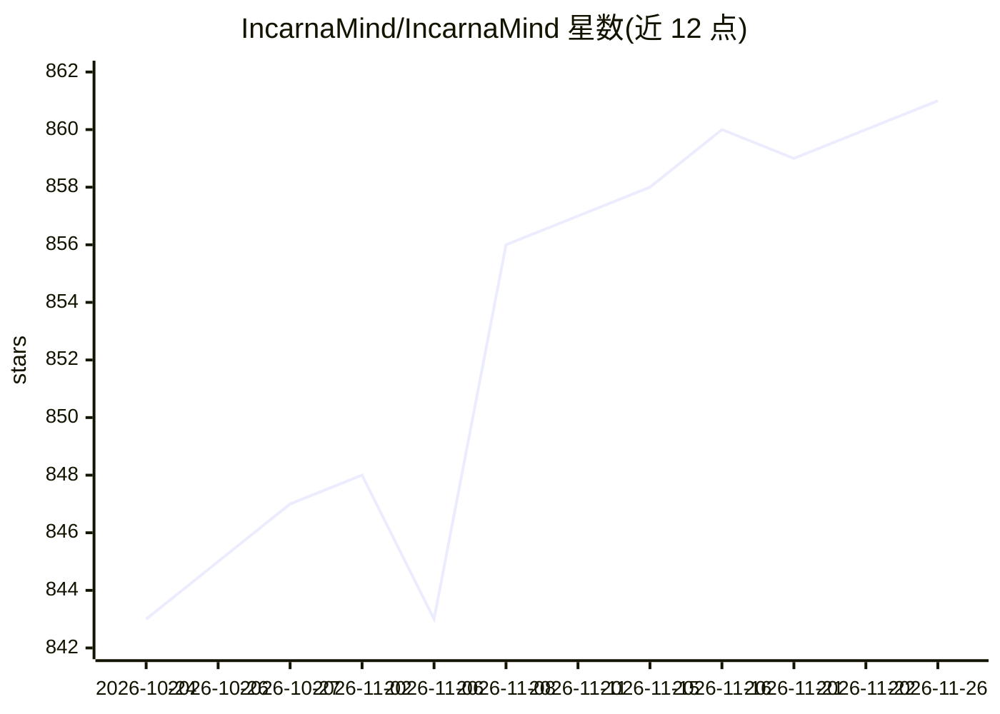

# IncarnaMind/IncarnaMind

⭐ 861 · TypeScript · Apache-2.0 · 推送 2026-11-25 · [GitHub](https://github.com/IncarnaMind/IncarnaMind) · 个人维护 · 中文 README

**桌面应用：核对 AI agent 产出与本地文件逐句一致**

面向 macOS/Windows/Linux 的开源桌面应用，将 Claude Code 等 agent 或内置助手写入的 Note 逐句对照用户本地文件，标注支持程度并给出引用页码；表格数字按数值比较并由本地代码重算。文件库支持 PDF/Word/PowerPoint/Excel 原地读取与检索，提供本地会议转录、Word 编辑导出与文献引用管理。模型可接 ChatGPT 计划、自备 API key 或 Ollama 本地模型，无需注册账号，Alpha 阶段构建未签名。

## 筛选速览

| 维度 | 判定 | 备注 |
|---|---|---|
| AI 角色 | `ai-native` | 本体是模型或模型工具 |
| 许可风险 | `permissive` | Apache-2.0 |
| 部署形态 | `desktop` | 安装包/桌面程序 |
| 模型依赖 | local-ok | 支持本地模型 |
| 硬件要求 | — | 无带数字的原话,不猜 |
| 安装摩擦 | `low` | 无编译、无系统依赖或容器化 |
| 成熟度 | `idea` | |

## 能力要点

- Note/文档逐句对照本地文件核查并标记引用页码
- 支持接入 Claude Code 等 agent，或内置助手起草与图表分析
- Ollama 本地模型可完全离线运行，文件不离开电脑
- Word 文件编辑导出保留未改动部分，支持八种引用格式脚注

## 适用场景

- 让 agent 起草备忘录后逐句核对其与原始文件是否一致
- 集中管理 PDF/Word/Excel 文档并跨文档提问获得页码引用
- 会议现场本地转录并生成标注发言人出处的纪要
- 处理客户机密文件时保持本地存储、仅发送必要内容给所选模型

## 场景标签

`AI 助手` `文档问答` `知识库管理` `文档解析` · 领域:对话与助手

## 证据(README 行号)

> L7:  A free, open-source desktop app for macOS, Windows and Linux. Your files in one Library, sorted and searchable, you
> L57: |**Check**|Check a Note, or a PDF, Word file, deck or workbook someone sent you, against your files, sentence by se
> L64: Works fully offline with Ollama: nothing leaves your computer.

## 星数曲线

2026-10-24 843 → 2026-11-26 861（+18）

---
*卡片 v1 · prompt 1.4 · 生成 2026-11-26 · 置信度 high · 依据 README sha `47c5fbde8eb0` · [字段定义](../../DATASET.md)*
