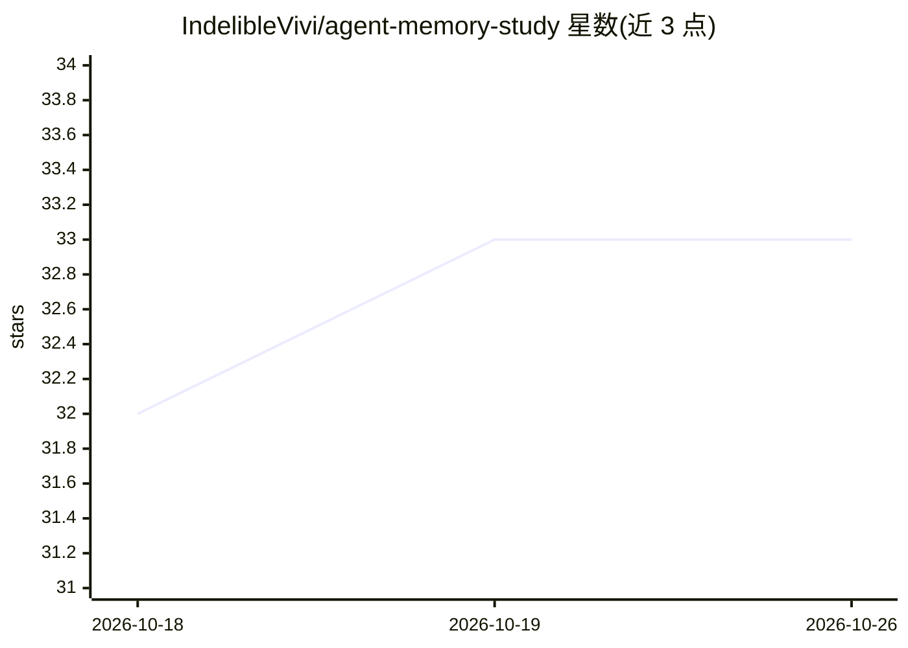

# IndelibleVivi/agent-memory-study

⭐ 33 · Python · 推送 2026-10-25 · [GitHub](https://github.com/IndelibleVivi/agent-memory-study) · [官网](https://indeliblevivi.github.io/agent-memory-study/) · 个人维护 · 中文 README

**agent memory 主题的来源链接式研究阅读库（12 文章/27 札记）**

个人维护的 agent memory、信念修正与经验复用研究仓库：以可修订的工作 thesis 为纲，收录 12 篇研究文章、27 份来源札记、2 个问题专题与 5 条实践判断，每篇配 Markdown/JSON 研究包与显式引用 manifest。提供 Node 导出脚本、Python 3.11+ 与 Node.js 本地构建流程，发布为 GitHub Pages 静态站点（三维研究体 + 研究星图，原生 WebGL）。验证脚本覆盖生成物一致性与既有确定性实验，不做 pretrained inference 或论文 benchmark 复现。

## 筛选速览

| 维度 | 判定 | 备注 |
|---|---|---|
| AI 角色 | `ai-knowledge` | 知识聚合/清单类 |
| 许可风险 | `none` | — |
| 部署形态 | `library` | 以包/库形式分发 |
| 模型依赖 | — | README 未给出锁定关系 |
| 硬件要求 | — | 无带数字的原话,不猜 |
| 安装摩擦 | `low` | 无编译、无系统依赖或容器化 |
| 成熟度 | — | 结构信号不足 |

## 能力要点

- Markdown/JSON 同源研究包，含署名、范围、版本日期与显式 ID 引用
- node tools/export_study.cjs 按类型与 ID 导出研究包
- 本地构建链：content.py 编译 materials.json，build.py 生成前端数据文件
- 静态站点含三维研究体与研究星图，无需 backend，笔记仅存页面内存与本地文件

## 适用场景

- 系统阅读 agent memory 与信念修正领域的原始文献与研究笔记
- 导出带引用 manifest 的研究包用于固定引用或离线阅读
- 在本地复现构建与验证流程后自行增补研究条目

## 场景标签

`科研工具` `精选清单` · 领域:学习与行业

## 证据(README 行号)

> L5: AMS 从 agent memory 出发，研究信息、经验与智能的跨时间关系。我们关心经验怎样获得形式，过去怎样参与当下，以及系统怎样在改变中保持连续性。IR、表示、学习、数据系统及其基础问题，都可以在这里独立深入。
> L21: 这些新文章是基于公开来源与原创例子写成的研究内容，不是私人聊天的重建。当前有 12 篇学习／研究文章、27 份来源札记、2 个问题专题、5 条实践判断。领域与方向只是可改的阅读地图；数量、关联和阅读深度不代表个人掌握度。
> L33: |`study/programme/`|工作 thesis、研究方法与长期方向的完整论述|

## 星数曲线

2026-10-18 32 → 2026-10-26 33（+1）

---
*卡片 v1 · prompt 1.4 · 生成 2026-10-25 · 置信度 high · 依据 README sha `014bea0e80be` · [字段定义](../../DATASET.md)*
