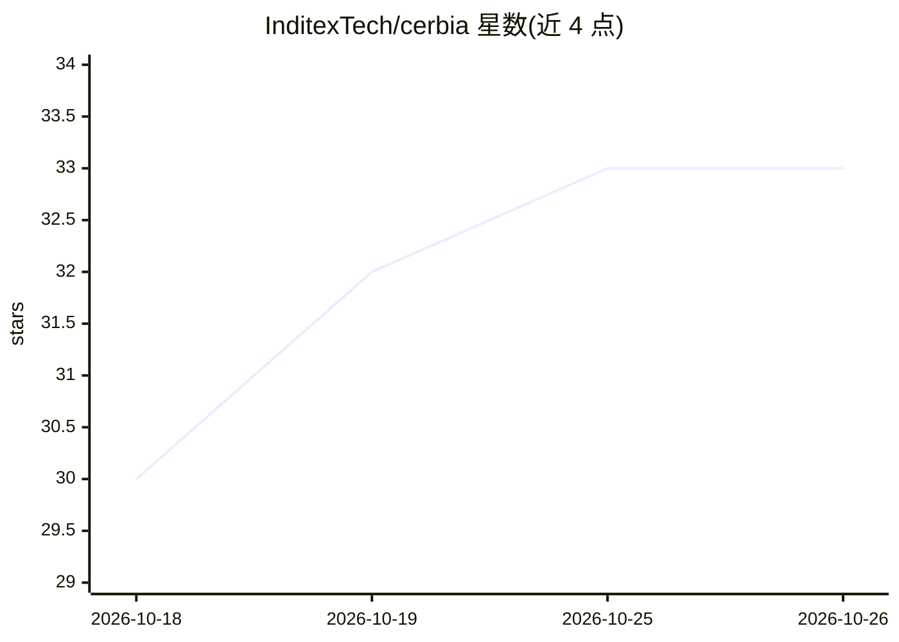

# InditexTech/cerbia

⭐ 33 · Python · Apache-2.0 · 推送 2026-10-22 · [GitHub](https://github.com/InditexTech/cerbia) · [官网](https://inditextech.github.io/cerbia/) · 组织维护

**面向 AI/LLM 管道的模块化威胁检测库：可配置安全门**

InditexTech 维护的 Python 库，围绕 AI agent 的输入输出构建安全门（gate）：门加载内容、可选预处理（多层去混淆）、运行扫描器、聚合阻断风险并返回判定。集成项包括本地 ML、Presidio PII 检测与 ProtectAI 提示注入扫描器。提供 cerbia 命令行接口扫描文本或文件，配置通过 YAML 定义。要求 Python 3.12+。README 声明扫描结果是启发式或基于模型的信号而非安全认证，需结合自身威胁模型评估。

## 筛选速览

| 维度 | 判定 | 备注 |
|---|---|---|
| AI 角色 | `ai-ecosystem` | LLM/agent 周边工具 |
| 许可风险 | `permissive` | Apache-2.0 |
| 部署形态 | `library` | 以包/库形式分发 |
| 模型依赖 | — | README 未给出锁定关系 |
| 硬件要求 | — | 无带数字的原话,不猜 |
| 安装摩擦 | `low` | 无编译、无系统依赖或容器化 |
| 成熟度 | — | 结构信号不足 |

## 能力要点

- loaders/preprocessors/scanners/聚合器组成可配置安全门
- CLI 支持扫描内联文本或文件
- 可选 Presidio PII 与 ProtectAI 提示注入扫描器集成
- Apache-2.0 许可，附第三方许可声明

## 适用场景

- 为 AI agent 的输入输出加检测与阻断门
- 检测提示注入与 PII 泄露
- 在 LLM 管道中按配置聚合风险评分

## 场景标签

`网络安全` · 领域:学习与行业

## 证据(README 行号)

> L14: CerbIA composes security gates around AI agents' inputs and outputs. A gate loads
> L15: content, optionally preprocesses it, runs scanners, aggregates blocking risk,

## 星数曲线

2026-10-18 30 → 2026-10-26 33（+3）

---
*卡片 v1 · prompt 1.4 · 生成 2026-10-25 · 置信度 high · 依据 README sha `67d84c25668e` · [字段定义](../../DATASET.md)*
