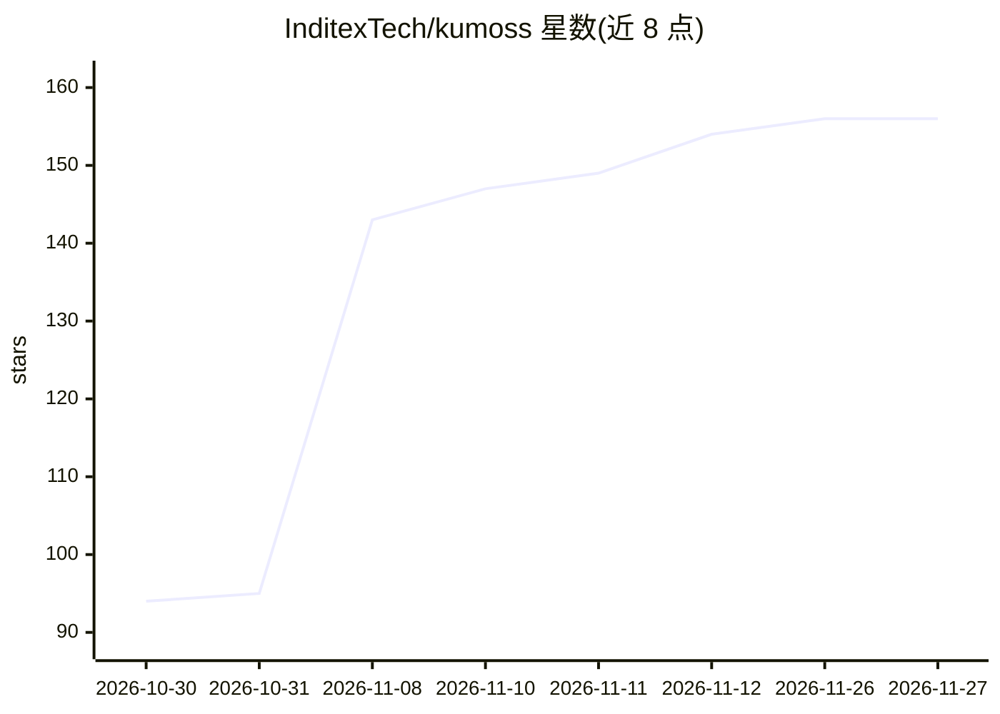

# InditexTech/kumoss

⭐ 156 · Python · Apache-2.0 · 推送 2026-11-26 · [GitHub](https://github.com/InditexTech/kumoss) · [官网](https://inditextech.github.io/kumoss) · 组织维护

**给平台/开发团队用自然语言生成合规 Terraform PR 的助手**

面向 day-2 云基础设施运维的助手与 harness：将自然语言请求转化为经过 plan 验证的 Terraform/OpenTofu 拉取请求，包含漂移检测与回写、OPA 合规检查与管理员审批。通过 LiteLLM 接入任意自配模型，多云支持 AWS/Azure/GCP/OCI/Kubernetes/vSphere，组件（授权、IaC 执行器、通知、仓库映射）以 OpenAPI sidecar 契约形式可替换，带 FastAPI、管理面板与 OpenTelemetry/Langfuse 追踪。全栈可由 Docker Compose 本地运行。

## 筛选速览

| 维度 | 判定 | 备注 |
|---|---|---|
| AI 角色 | `ai-native` | 本体是模型或模型工具 |
| 许可风险 | `permissive` | Apache-2.0 |
| 部署形态 | `self-host` | docker 或自建部署 |
| 模型依赖 | — | README 未给出锁定关系 |
| 硬件要求 | — | 无带数字的原话,不猜 |
| 安装摩擦 | `low` | 无编译、无系统依赖或容器化 |
| 成熟度 | — | 结构信号不足 |

## 能力要点

- 自然语言到已验证 plan 的 Terraform/OpenTofu PR，含漂移修复与资源导入
- 模型经 LiteLLM 自选（含自托管），身份走任意 OIDC 提供商
- 授权、IaC、通知、仓库映射为 OpenAPI sidecar 契约，可整体替换
- 高风险/不合规变更锁会话等待管理员审批，OpenTelemetry + Langfuse 全链路追踪

## 适用场景

- 开发者用一句话自助创建和变更基础设施，无需 HCL 经验
- 平台团队把架构与安全标准变成每个请求都执行的 guardrails
- 检测云上漂移并在同一 PR 中回写修正
- 对每次基础设施变更做合规审计与成本估算报告

## 场景标签

`代码生成` · 领域:编码与开发

## 证据(README 行号)

> L5: AI assistant that helps developers manage day-two infrastructure through plain-language requests.
> L29: Kumoss turns **natural-language requests into reviewed, compliant Infrastructure as Code (IaC)**. Platform engineer
> L71: |**Model**|—|Any LiteLLM-supported model, including self-hosted ones, with web search included;|

## 星数曲线

2026-10-30 94 → 2026-11-27 156（+62）

---
*卡片 v1 · prompt 1.4 · 生成 2026-11-27 · 置信度 high · 依据 README sha `7b03a98ea589` · [字段定义](../../DATASET.md)*
