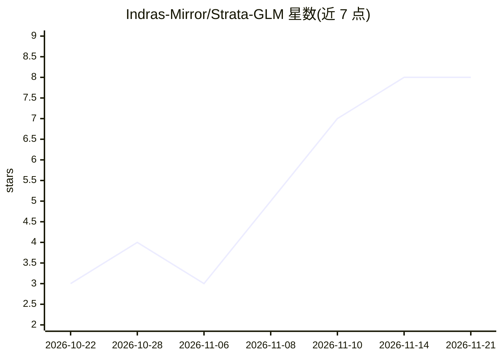

# Indras-Mirror/Strata-GLM

⭐ 8 · C++ · MIT · 推送 2026-10-10 · [GitHub](https://github.com/Indras-Mirror/Strata-GLM) · 个人维护

**消费级硬件上运行 GLM-5.3-Flash 320B MoE 的推理引擎**

基于 Strata 引擎的本地推理实现，面向 320B MoE 模型 GLM-5.3-Flash：热专家驻留 VRAM 缓存，其余放 pinned RAM arena，缺失专家经 CPU 与 PCIe 并行加载；配合 soft REAP 剪枝、分块 MMQ prefill 与弹性 VRAM 缓存。默认模型为 Maya-S-v2 量化版，可运行时挂载 rank-1 abliteration LoRA（--stock 可关闭）。对外提供 OpenAI 与 Anthropic 兼容 API。要求 Linux、CUDA 13.x、24 GB NVIDIA GPU 与约 80 GB 空闲内存，从源码编译，实验性单人研究代码，单序列处理。

## 筛选速览

| 维度 | 判定 | 备注 |
|---|---|---|
| AI 角色 | `ai-ecosystem` | LLM/agent 周边工具 |
| 许可风险 | `permissive` | MIT |
| 部署形态 | `None` |  |
| 模型依赖 | local-ok | 支持本地模型 |
| 硬件要求 | — | 无带数字的原话,不猜 |
| 安装摩擦 | `high` | 编译与系统依赖俱全 |
| 成熟度 | `idea` | |

## 能力要点

- 24 GB GPU + 90 GB RAM 上实测 512K 上下文、decode 25 tok/s、prefill ~400 tok/s
- VRAM/RAM 专家驻留 + soft REAP 剪枝 + 分块 MMQ prefill 的内存分层设计
- 运行时 abliteration LoRA，模型文件不被修改，--stock 可切换原版
- 提供 OpenAI /v1 与 Anthropic /v1/messages 兼容 API

## 适用场景

- 在单张 24 GB 游戏显卡上本地运行 320B MoE 大模型
- 需要 OpenAI/Anthropic 兼容 API 的本地推理服务
- 长上下文（512K）本地推理实验与性能测量

## 场景标签

`推理引擎` · 领域:训练与推理

## 证据(README 行号)

> L13: Strata is an inference engine built for large MoE models on consumer hardware.
> L112: **Serve it** (OpenAI `/v1` + Anthropic `/v1/messages` + `/health`). Edit the model and LoRA paths in the JSON firs

## 星数曲线

2026-10-22 3 → 2026-11-21 8（+5）

---
*卡片 v1 · prompt 1.4 · 生成 2026-11-20 · 置信度 high · 依据 README sha `6622e1aa1a7a` · [字段定义](../../DATASET.md)*
