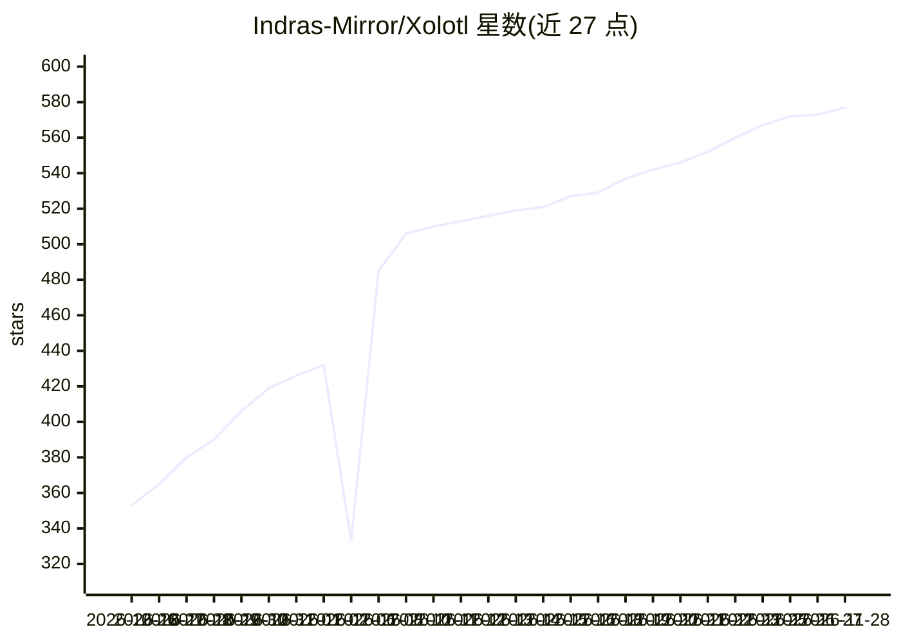

# Indras-Mirror/Xolotl

⭐ 577 · C++ · MIT · 推送 2026-11-27 · [GitHub](https://github.com/Indras-Mirror/Xolotl) · [官网](https://indrasmirror.au/blog-xolotl-frontier-models-one-gaming-pc) · 个人维护

**单张游戏 PC 本地运行 552B MoE 大模型的推理引擎**

在 Strata 引擎基础上扩展的本地 LLM 推理服务器：将 MoE 专家按热度分层放置于 VRAM、锁定内存与 NVMe，逐层预取，从而在一台 RTX 4090 + 110 GB RAM 的机器上以约 33 tok/s 运行 DeepSeek-V4.1-Flash（fast 模式约 41 tok/s，512K 上下文），并支持 GLM-5.3-Flash、Qwen3.8、Inkling-2-Mini 等模型及 LoRA 训练。对外提供 OpenAI/Anthropic 兼容 API。面向想要在本地跑超大模型的开发者和研究者；要求 Linux、NVIDIA GPU 与 CUDA，需从源码编译。

## 筛选速览

| 维度 | 判定 | 备注 |
|---|---|---|
| AI 角色 | `ai-ecosystem` | LLM/agent 周边工具 |
| 许可风险 | `permissive` | MIT |
| 部署形态 | `None` |  |
| 模型依赖 | local-ok | 支持本地模型 |
| 硬件要求 | — | 无带数字的原话,不猜 |
| 安装摩擦 | `high` | 编译与系统依赖俱全 |
| 成熟度 | — | 结构信号不足 |

## 能力要点

- MoE 专家分层放置于 VRAM/RAM/NVMe，逐 token 提前预取
- 单张 24 GB 卡上 512K 上下文、127 tok/s 的 Inkling-2-Mini 自研引擎
- OpenAI 与 Anthropic 兼容的本地服务接口
- 支持对所服务模型做 LoRA 训练

## 适用场景

- 在一台游戏 PC 上离线运行超大 MoE 编码模型
- 为本地编码 agent 提供私有推理后端
- 在 12-24 GB 显卡上按显存预算部署较小的 MoE 模型

## 场景标签

`推理引擎` · 领域:训练与推理

## 证据(README 行号)

> L1: Xolotl - frontier MoE models on one gaming PC
> L5:  DeepSeek-V4.1-Flash, all 552 billion parameters, on one gaming PC at 33 tok/s on real agent tasks (41 in fast mode)
> L141: A mixture-of-experts model only uses a few experts per token. Xolotl keeps every expert somewhere - the hottest in

## 星数曲线

2026-10-26 353 → 2026-11-28 577（+224）

---
*卡片 v1 · prompt 1.4 · 生成 2026-11-28 · 置信度 high · 依据 README sha `788eaa8bd396` · [字段定义](../../DATASET.md)*
