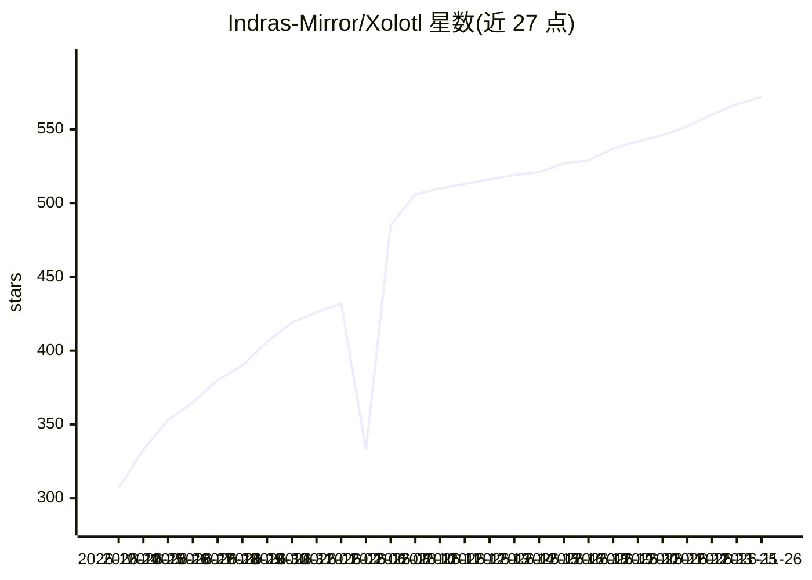

# Indras-Mirror/Xolotl

⭐ 572 · C++ · MIT · 推送 2026-11-24 · [GitHub](https://github.com/Indras-Mirror/Xolotl) · [官网](https://indrasmirror.au/blog-xolotl-frontier-models-one-gaming-pc) · 个人维护

**让游戏级单机 PC 本地运行 552B MoE 大模型的推理引擎与服务端**

Xolotl 是一个基于 Strata 扩展的本地 LLM 推理引擎与模型服务端，支持在单张 RTX 4090（24 GB）加约 110 GB RAM 与 NVMe 的配置上运行 DeepSeek-V4.1-Flash（552B MoE）等模型，输出 OpenAI/Anthropic 兼容 API，客户端指向本地 /v1 端点即可使用。核心机制是 MoE 专家跨 VRAM、锁定内存、NVMe 三层放置并预取，另含混合精度量化、MTP/n-gram 投机解码、4-bit KV cache 支持 512K 上下文、可选 fast mode 以及为各模型提供的专用引擎与 LoRA 训练。平台限定 Linux（DeepSeek-V4.1 另支持 Windows 11）、NVIDIA GPU、CUDA 12.x/13.x，需源码编译，MIT 许可。

## 筛选速览

| 维度 | 判定 | 备注 |
|---|---|---|
| AI 角色 | `ai-ecosystem` | LLM/agent 周边工具 |
| 许可风险 | `permissive` | MIT |
| 部署形态 | `None` |  |
| 模型依赖 | local-ok | 支持本地模型 |
| 硬件要求 | — | 无带数字的原话,不猜 |
| 安装摩擦 | `high` | 编译与系统依赖俱全 |
| 成熟度 | — | 结构信号不足 |

## 能力要点

- MoE 专家跨 VRAM/RAM/NVMe 分层放置，单张 4090 运行 552B MoE 模型
- 提供 OpenAI 与 Anthropic 兼容服务端，客户端指向本地 /v1 端点
- DeepSeek-V4.1、GLM-5.3-Flash、Qwen3.8、Inkling-2-Mini 各配专用引擎
- 支持对已服务模型做 LoRA 训练及可选 fast mode 加速

## 适用场景

- 在没有数据中心 GPU 的游戏 PC 上本地运行超大 MoE 模型
- 给本地编码 agent 提供低延迟的 OpenAI 兼容 API 后端
- 在 24 GB 显存的消费级显卡上运行带 512K 上下文与视觉能力的小模型

## 场景标签

`推理引擎` · 领域:训练与推理

## 证据(README 行号)

> L5:  DeepSeek-V4.1-Flash, all 552 billion parameters, on one gaming PC at 33 tok/s on real agent tasks (41 in fast mode)
> L132: Then point any OpenAI- or Anthropic-compatible client at `http://127.0.0.1:<port>/v1`.
> L136: A mixture-of-experts model only uses a few experts per token. Xolotl keeps every expert somewhere - the hottest in

## 星数曲线

2026-10-24 307 → 2026-11-26 572（+265）

---
*卡片 v1 · prompt 1.4 · 生成 2026-11-25 · 置信度 high · 依据 README sha `430fbc13fcf6` · [字段定义](../../DATASET.md)*
