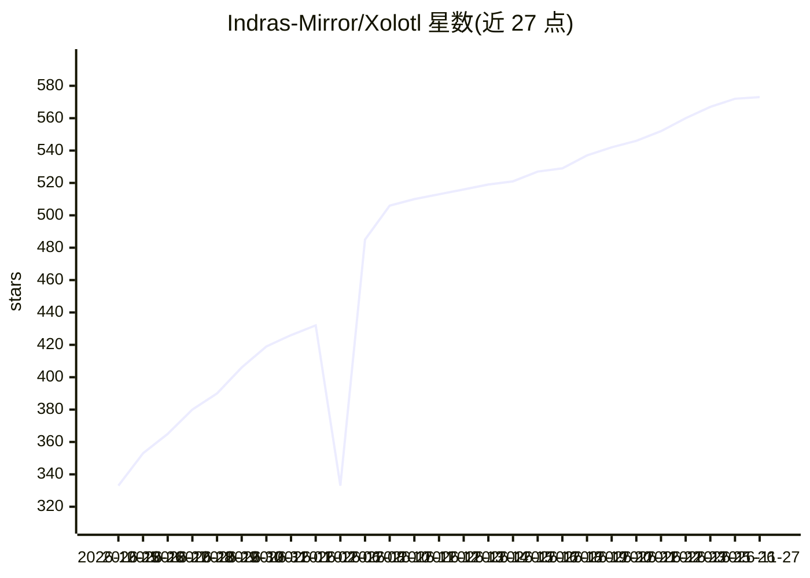

# Indras-Mirror/Xolotl

⭐ 573 · C++ · MIT · 推送 2026-11-26 · [GitHub](https://github.com/Indras-Mirror/Xolotl) · [官网](https://indrasmirror.au/blog-xolotl-frontier-models-one-gaming-pc) · 组织维护

**消费级 PC 上本地运行 552B MoE 大模型的推理引擎与服务器**

基于 Strata 引擎扩展的本地 LLM 推理引擎，将 MoE 专家分层放置在 VRAM、固定内存与 NVMe 上，按路由逐层预取，使单张 RTX 4090 加大容量 RAM 的机器可运行 DeepSeek-V4.1-Flash 等模型，并提供 OpenAI/Anthropic 兼容服务器。附带自研 Inkling-2-Mini 引擎（24 GB 卡上 512K 上下文、视觉、MTP 起草）、量化、快速模式与 LoRA 微调。面向有 NVIDIA GPU 与 Linux/Windows 环境的本地部署用户，需从源码用 CMake 编译。

## 筛选速览

| 维度 | 判定 | 备注 |
|---|---|---|
| AI 角色 | `ai-ecosystem` | LLM/agent 周边工具 |
| 许可风险 | `permissive` | MIT |
| 部署形态 | `None` |  |
| 模型依赖 | local-ok | 支持本地模型 |
| 硬件要求 | — | 无带数字的原话,不猜 |
| 安装摩擦 | `high` | 编译与系统依赖俱全 |
| 成熟度 | — | 结构信号不足 |

## 能力要点

- MoE 专家跨 VRAM/RAM/NVMe 分层与逐 token 路由预取
- OpenAI- 与 Anthropic 兼容的本地服务器，多模型统一接入
- fast mode 读取 2-bit 专家副本提升解码速度（有损、可选）
- Inkling-2-Mini 自研引擎：单张 24 GB 卡 512K 上下文与 LoRA 训练

## 适用场景

- 在没有数据中心硬件的本地机器上运行超大 MoE 模型
- 为本地 coding agent 提供兼容 OpenAI/Anthropic 的推理后端
- 在有限显存卡上测试量化与推测解码等推理加速方案

## 场景标签

`推理引擎` `模型量化` · 领域:训练与推理

## 证据(README 行号)

> L5:  DeepSeek-V4.1-Flash, all 552 billion parameters, on one gaming PC at 33 tok/s on real agent tasks (41 in fast mode)
> L103: Linux (or Windows 11 for DeepSeek-V4.1, docs/WINDOWS.md), an NVIDIA GPU, CUDA 12.x/13.x, and as much RAM as you ca
> L136: Then point any OpenAI- or Anthropic-compatible client at `http://127.0.0.1:<port>/v1`.

## 星数曲线

2026-10-25 333 → 2026-11-27 573（+240）

---
*卡片 v1 · prompt 1.4 · 生成 2026-11-27 · 置信度 high · 依据 README sha `31e3ea2e328a` · [字段定义](../../DATASET.md)*
