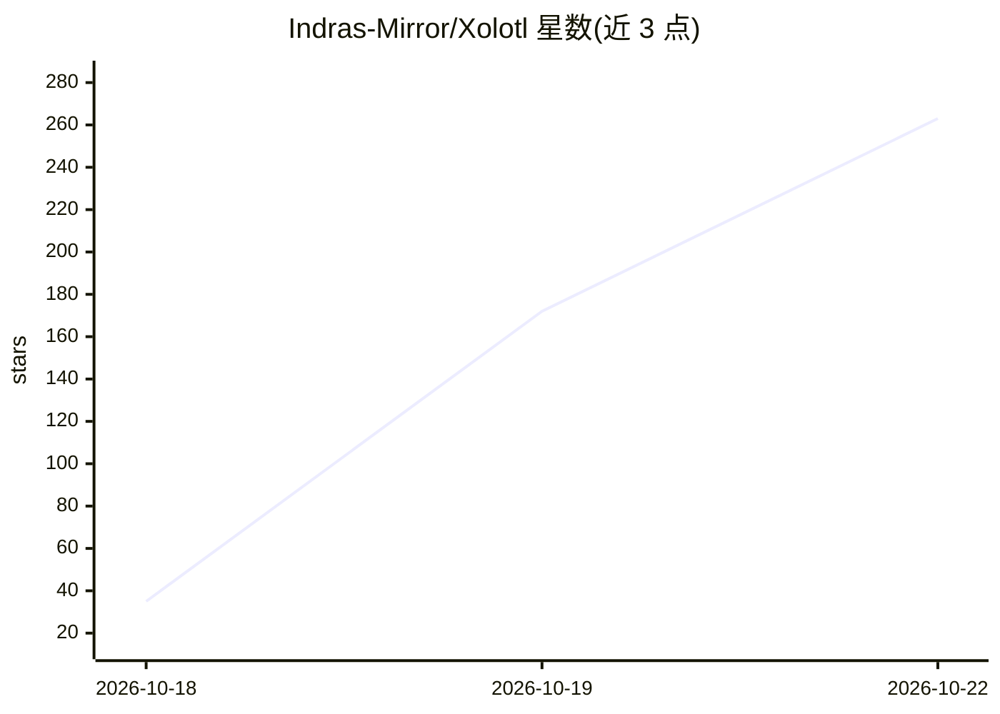

# Indras-Mirror/Xolotl

⭐ 263 · C++ · MIT · 推送 2026-10-21 · [GitHub](https://github.com/Indras-Mirror/Xolotl) · [官网](https://github.com/Niko1221/Strata) · 个人维护

**在单张游戏显卡上运行 552B MoE 模型的推理引擎**

基于 Strata 深度扩展的本地 MoE 推理引擎（约新增 7.1 万行），提供 DeepSeek-V4.1-Flash（552B）、GLM-5.3-Flash（320B）、Qwen3.8-Flash-Next（125B）与 Qwen3.8-27B 四个模型引擎，各自带量化与专家分层方案。核心机制是将 MoE 专家按热度分层于 VRAM、pinned RAM 与 NVMe，按路由逐层提前搬运；服务端输出 OpenAI/Anthropic 兼容 API，支持工具调用、流式输出、投机解码、512K 上下文与多卡分层。限制：需 Linux 或 Windows 原生构建、NVIDIA 卡（compute capability ≥7.5）、约 152 GiB 权重盘与较大内存，从源码用 CMake/Ninja 编译安装。

## 筛选速览

| 维度 | 判定 | 备注 |
|---|---|---|
| AI 角色 | `ai-ecosystem` | LLM/agent 周边工具 |
| 许可风险 | `permissive` | MIT |
| 部署形态 | `None` |  |
| 模型依赖 | — | README 未给出锁定关系 |
| 硬件要求 | `gpu-24g` | |
| 安装摩擦 | `high` | 编译与系统依赖俱全 |
| 成熟度 | — | 结构信号不足 |

## 能力要点

- DeepSeek-V4.1-Flash 552B 在 RTX 4090 + 90GB RAM 上约 27 tok/s 解码
- 专家三层分层（VRAM/pinned RAM/NVMe）+ 逐 token 路由预取
- OpenAI/Anthropic 兼容服务端，支持工具调用、流式与 512K 上下文
- 多卡分层、对话池缓存、bit-exact 恢复与压缩 KV 等扩展

## 适用场景

- 在单张 24GB 显卡的游戏 PC 上本地跑前沿 MoE 大模型
- 把 Claude Code、Codex 等编码 agent 指向本地 OpenAI 兼容服务
- 在显存不足的机器上做大模型本地推理实验与基准测试

## 场景标签

`推理引擎` · 领域:训练与推理

## 证据(README 行号)

> L6: Plus GLM-5.3-Flash, Qwen3.8-Flash-Next and Qwen3.8-27B: one engine, one OpenAI / Anthropic-compatible server.
> L106: Then point any OpenAI- or Anthropic-compatible client at `http://127.0.0.1:<port>/v1`.
> L158: from RAM and NVMe. Research code from one developer, measured on one PC; reports from other hardware welcome. MIT.

## 星数曲线

2026-10-18 35 → 2026-10-22 263（+228）

---
*卡片 v1 · prompt 1.4 · 生成 2026-10-22 · 置信度 high · 依据 README sha `0862a43fc662` · [字段定义](../../DATASET.md)*
