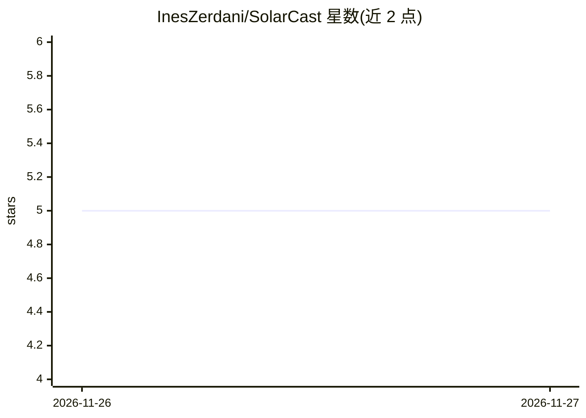

# InesZerdani/SolarCast

⭐ 5 · Jupyter Notebook · 推送 2026-10-30 · [GitHub](https://github.com/InesZerdani/SolarCast) · 个人维护

**光伏发电功率预测与储能调度优化项目**

基于机器学习的光伏电站发电量预测项目：以印度某光伏电站公开数据集（34 天、15 分钟粒度、22 个逆变器）与 Open-Meteo/ERA5 气象再分析数据为输入，用 XGBoost 与 Random Forest 做 1 小时及多时距（15 分钟至 6 小时）预测，并以持续性模型为基准计算 skill score。以 6 个 Jupyter notebook 组织探索、清洗、特征工程与建模流程，附 Streamlit 仪表盘。下一步计划是基于预测结果优化储能电池调度。

## 筛选速览

| 维度 | 判定 | 备注 |
|---|---|---|
| AI 角色 | `ai-native` | 本体是模型或模型工具 |
| 许可风险 | `none` | — |
| 部署形态 | `library` | 以包/库形式分发 |
| 模型依赖 | — | README 未给出锁定关系 |
| 硬件要求 | — | 无带数字的原话,不猜 |
| 安装摩擦 | `low` | 无编译、无系统依赖或容器化 |
| 成熟度 | — | 结构信号不足 |

## 能力要点

- 多时距发电量预测并给出与持续性基准的 skill score 对比
- 以 pvlib 计算太阳位置、循环编码与滞后变量等特征工程
- 检测并处理 DC 功率 ×10 量级误差等数据异常
- 提供 requirements.txt 安装与 Streamlit 仪表盘运行方式

## 适用场景

- 为并网申报提前预测光伏电站出力
- 复现学习光伏功率预测的完整建模流程
- 评估不同预测时距下模型相对基准的增益

## 场景标签

 · 领域:能源/时间序列预测

## 证据(README 行号)

> L3: Prévision de production photovoltaïque par apprentissage automatique, à
> L27: |XGBoost|4003|28,3 %|
> L72: Python, pandas, NumPy, scikit-learn, XGBoost, pvlib, Streamlit,

## 星数曲线

2026-11-26 5 → 2026-11-27 5（+0）

---
*卡片 v1 · prompt 1.4 · 生成 2026-11-26 · 置信度 high · 依据 README sha `795c20ddb9ca` · [字段定义](../../DATASET.md)*
