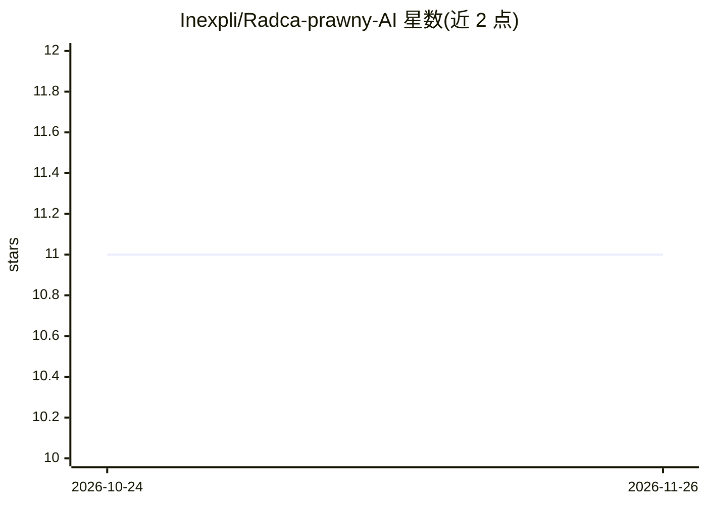

# Inexpli/Radca-prawny-AI

⭐ 11 · Python · MIT · 推送 2026-01-08 · [GitHub](https://github.com/Inexpli/Radca-prawny-AI) · 个人维护

**基于波兰法律的全本地私有 RAG 法律咨询助手**

一个完全本地化运行的 RAG 法律问答系统，基于波兰现行法律条文（从 ISAP 自动下载并索引宪法、刑法、民法、劳动法等 6 部法典）生成结构化法律意见并引用来源。检索采用三段式混合方案：e5-large 语义向量 + BM25 关键词检索 + polish-reranker-roberta-v3 重排序；生成端使用 4-bit 量化的 Bielik-11B-v2.6-Instruct 模型，并强制仅基于检索上下文作答。提供 Streamlit 网页界面与 CLI 两种使用方式，支持会话历史持久化与查询改写。限制：需要 24 GB VRAM 的 NVIDIA GPU 与 32 GB 内存，仅覆盖波兰法律。

## 筛选速览

| 维度 | 判定 | 备注 |
|---|---|---|
| AI 角色 | `ai-native` | 本体是模型或模型工具 |
| 许可风险 | `permissive` | MIT |
| 部署形态 | `library` | 以包/库形式分发 |
| 模型依赖 | — | README 未给出锁定关系 |
| 硬件要求 | `gpu-24g` | |
| 安装摩擦 | `medium` | 含编译或系统依赖之一 |
| 成熟度 | — | 结构信号不足 |

## 能力要点

- 三段式混合检索：Dense（e5-large）+ Sparse（BM25）+ Cross-Encoder 重排序
- 生成模型为 Bielik-11B-v2.6-Instruct（4-bit NF4 量化），全程离线运行
- 自动从 ISAP 下载并索引 6 部波兰法典，回答附来源引用
- Query Rewriting 机制支持依赖上下文的追问

## 适用场景

- 离线查询波兰法律条文并获得结构化法律意见
- 处理敏感案件材料时不希望数据离开本机
- 对特定条款编号做精确检索与追问

## 场景标签

`RAG` `文档问答` · 领域:知识与检索

## 证据(README 行号)

> L3: **Radca Prawny AI** to zaawansowany system **RAG (Retrieval-Augmented Generation)** zaprojektowany do udzielania por
> L5: System łączy **Wyszukiwanie Hybrydowe** (Semantyczne + Słowa Kluczowe) i **Reranking** z potężnym polskim modelem ję
> L27: * **LLM:** `speakleash/Bielik-11B-v2.6-Instruct` (Kwantyzacja 4-bit NF4).

## 星数曲线

2026-10-24 11 → 2026-11-26 11（+0）

---
*卡片 v1 · prompt 1.4 · 生成 2026-11-19 · 置信度 high · 依据 README sha `215d1c3f78a4` · [字段定义](../../DATASET.md)*
