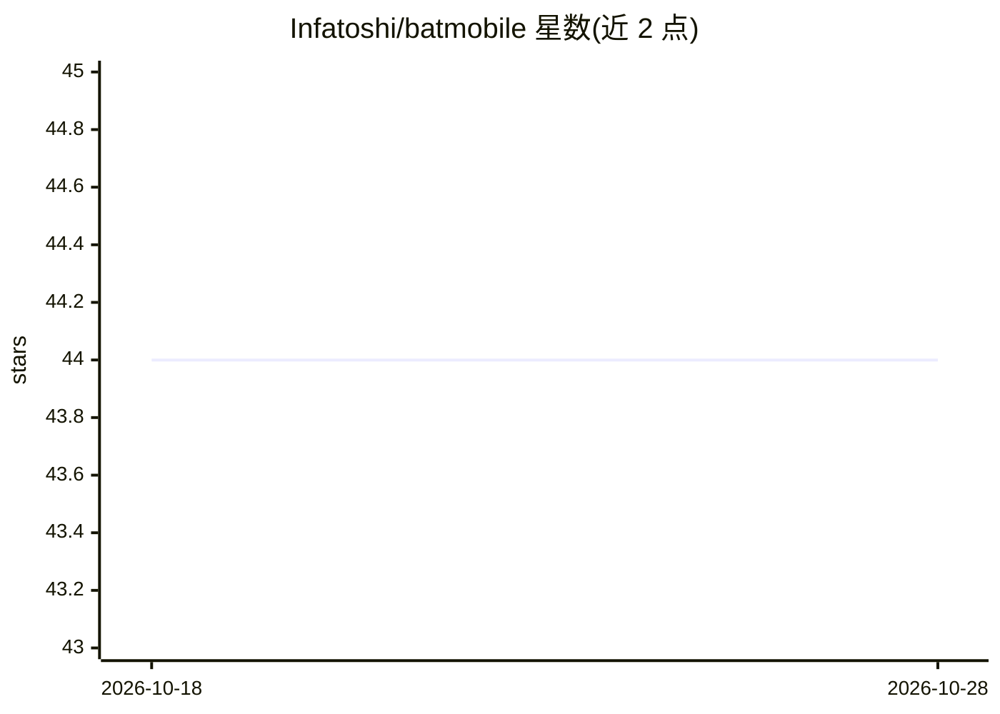

# Infatoshi/batmobile

⭐ 44 · Cuda · MIT · 推送 2026-01-17 · [GitHub](https://github.com/Infatoshi/batmobile) · 个人维护

**等变图神经网络的 CUDA 核函数库：加速 MACE/NequIP 类模型计算**

面向等变图神经网络（MACE、NequIP、Allegro）的 CUDA 核函数库，提供球谐函数、带 Clebsch-Gordan 系数的张量积、融合消息传递等算子的 CUDA 实现，面向 L_max=3，目标场景为分子动力学与材料科学。所有操作支持 PyTorch autograd，以 pip 源码安装方式提供（需 CUDA toolkit 与 PyTorch 2.0+）。README 给出 RTX 3090 上相对 e3nn 的基准数据，并提供基准复现脚本。

## 筛选速览

| 维度 | 判定 | 备注 |
|---|---|---|
| AI 角色 | `ai-ecosystem` | LLM/agent 周边工具 |
| 许可风险 | `permissive` | MIT |
| 部署形态 | `library` | 以包/库形式分发 |
| 模型依赖 | — | README 未给出锁定关系 |
| 硬件要求 | — | 无带数字的原话,不猜 |
| 安装摩擦 | `medium` | 含编译或系统依赖之一 |
| 成熟度 | — | 结构信号不足 |

## 能力要点

- 球谐函数、张量积、融合 SH+TP 的 CUDA 实现，支持 L_max=3
- 所有操作支持 PyTorch autograd，含手动 backward 接口
- README 提供 RTX 3090 上相对 e3nn 的基准数据与复现脚本

## 适用场景

- 加速 MACE/NequIP/Allegro 类等变 GNN 的训练与推理
- 分子动力学与材料科学工作流中替换 e3nn 算子
- 复现或运行 README 中的基准测试

## 场景标签

 · 领域:分子模拟/科学计算加速

## 证据(README 行号)

> L3: High-performance CUDA kernels for equivariant graph neural networks. Batmobile provides optimized implementations of
> L7: Requires CUDA toolkit (tested with CUDA 12.x) and PyTorch 2.0+.

## 星数曲线

2026-10-18 44 → 2026-10-28 44（+0）

---
*卡片 v1 · prompt 1.4 · 生成 2026-10-25 · 置信度 high · 依据 README sha `0a392fbf6c6a` · [字段定义](../../DATASET.md)*
