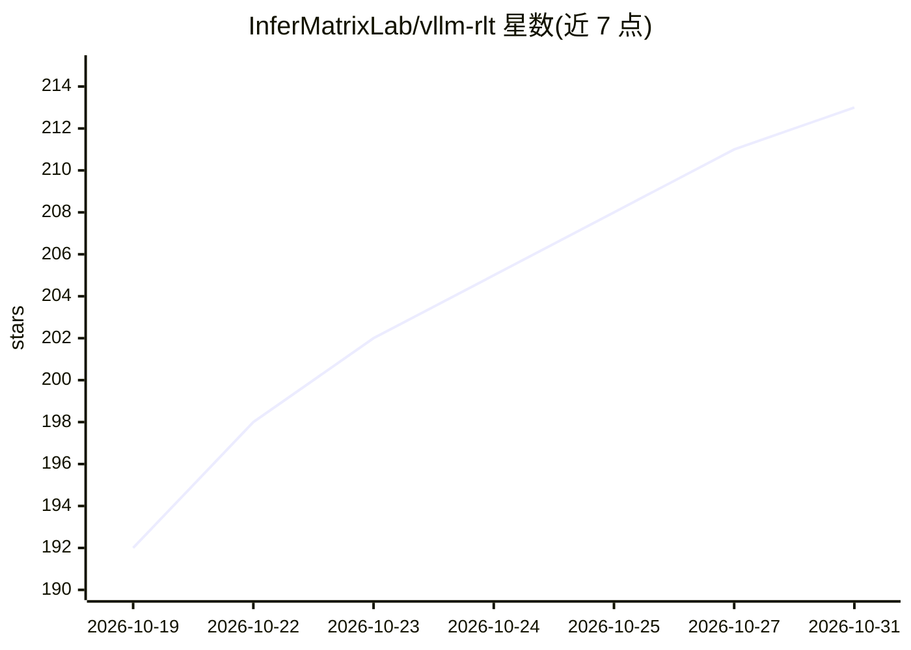

# InferMatrixLab/vllm-rlt

⭐ 213 · Python · Apache-2.0 · 推送 2026-10-30 · [GitHub](https://github.com/InferMatrixLab/vllm-rlt) · 组织维护

**循环 Transformer 语言模型的独立推理与服务引擎**

面向循环/递归型语言模型（Ouro、Nanbeige4.2、Huginn 等 checkpoint）的推理与服务引擎，采用 vLLM 式引擎组织并实现论文中的 Continuous Depth Batching 思想，可独立运行、不要求安装 vLLM。核心机制：循环级连续批处理（不同循环深度的请求共享批次）、深度感知分页 KV 缓存、CUDA Graphs、自投机解码、单机 prefill/decode 分离。提供 Python API、CLI 与流式 OpenAI 兼容接口。v0.1.0 为实验版本，异步执行与自投机存在已知未解决问题；性能数据为诊断性测量，非生产资格认证。

## 筛选速览

| 维度 | 判定 | 备注 |
|---|---|---|
| AI 角色 | `ai-ecosystem` | LLM/agent 周边工具 |
| 许可风险 | `permissive` | Apache-2.0 |
| 部署形态 | `library` | 以包/库形式分发 |
| 模型依赖 | — | README 未给出锁定关系 |
| 硬件要求 | — | 无带数字的原话,不猜 |
| 安装摩擦 | `medium` | 含编译或系统依赖之一 |
| 成熟度 | `idea` | |

## 能力要点

- 循环级连续批处理：不同循环深度请求可共享批次并中途进出
- 深度感知分页 KV 缓存、可选前缀缓存与优先级调度
- CUDA Graphs、异步自投机与单机 prefill/decode 分离（NIXL KV 传输）
- 提供 Python API、CLI 与流式 OpenAI 兼容 completions 端点

## 适用场景

- 部署 Ouro/Nanbeige/Huginn 等循环语言模型做推理服务
- 用 OpenAI 兼容接口对接现有客户端做流式生成
- 研究循环模型的自适应早退与投机解码的推理行为

## 场景标签

`推理引擎` · 领域:训练与推理

## 证据(README 行号)

> L26: **vllm-rlt** is a standalone inference and serving engine for recurrent language
> L39: The project follows a vLLM-style engine organization and implements runtime

## 星数曲线

2026-10-19 192 → 2026-10-31 213（+21）

---
*卡片 v1 · prompt 1.4 · 生成 2026-10-22 · 置信度 mid · 依据 README sha `9daac76a347a` · [字段定义](../../DATASET.md)*
