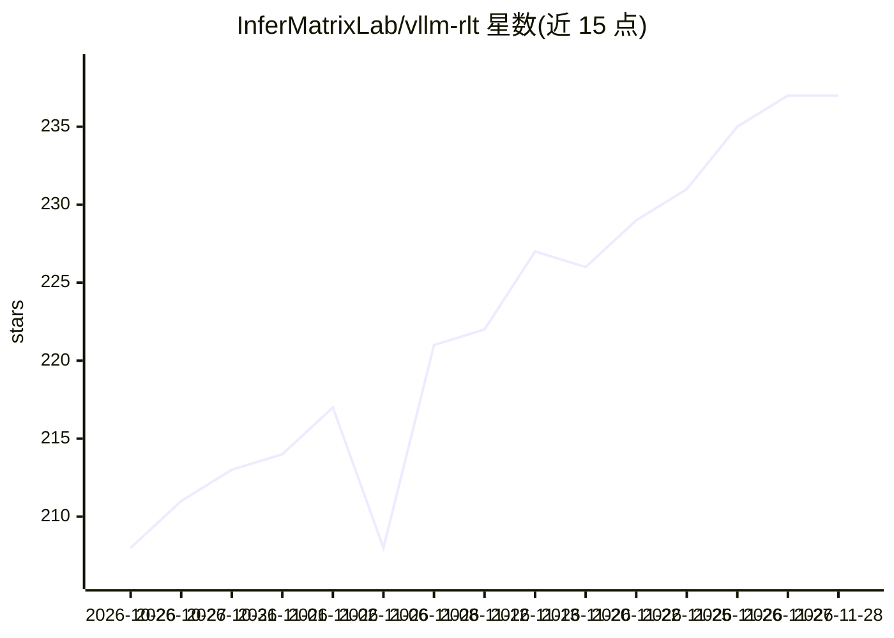

# InferMatrixLab/vllm-rlt

⭐ 237 · Python · Apache-2.0 · 推送 2026-11-27 · [GitHub](https://github.com/InferMatrixLab/vllm-rlt) · 组织维护 · 中文 README

**面向循环语言模型的独立推理与服务引擎**

受 vLLM 架构启发但独立运行的推理与服务引擎，针对循环语言模型：按循环层级做连续批处理，让不同深度的请求共享批次，包含 Stage/Loop 架构、wavefront chunked prefill（WCPB）、实验性 token 级解码流水线、深度感知分页 KV 缓存与早退门控。提供 Python API、CLI 与流式 OpenAI 兼容 completions 端点（非 chat-completions）。v0.2.0 为研究/评估里程碑，高级功能需显式开启且有模型特定约束；服务器无内置认证或 TLS。

## 筛选速览

| 维度 | 判定 | 备注 |
|---|---|---|
| AI 角色 | `ai-ecosystem` | LLM/agent 周边工具 |
| 许可风险 | `permissive` | Apache-2.0 |
| 部署形态 | `library` | 以包/库形式分发 |
| 模型依赖 | — | README 未给出锁定关系 |
| 硬件要求 | — | 无带数字的原话,不猜 |
| 安装摩擦 | `medium` | 含编译或系统依赖之一 |
| 成熟度 | `idea` | |

## 能力要点

- 循环级连续批处理：不同深度的请求共享批次而非等待整批完成
- Stage/Loop 架构统一 prefill 与 decode 的调度与执行
- 深度感知分页 KV 缓存（LAST_EXITED/SHARED 布局、前缀复用、抢占）
- Python API、CLI 与流式 OpenAI 兼容 completions 端点

## 适用场景

- 对 Ouro/Huginn/Dory 等循环语言模型做离线推理
- 部署 OpenAI 兼容的 completions 流式服务端点
- 研究深度自适应推理与早退策略的质量影响

## 场景标签

`推理引擎` · 领域:训练与推理

## 证据(README 行号)

> L27: **vllm-rlt** is a standalone inference and serving engine for **recurrent
> L71: - **Offline and online use:** Python API, CLI, and a streaming
> L75: > **v0.2.0 is a research/evaluation milestone.** Default execution is synchronous;

## 星数曲线

2026-10-26 208 → 2026-11-28 237（+29）

---
*卡片 v1 · prompt 1.4 · 生成 2026-11-26 · 置信度 mid · 依据 README sha `be6dc81a0995` · [字段定义](../../DATASET.md)*
