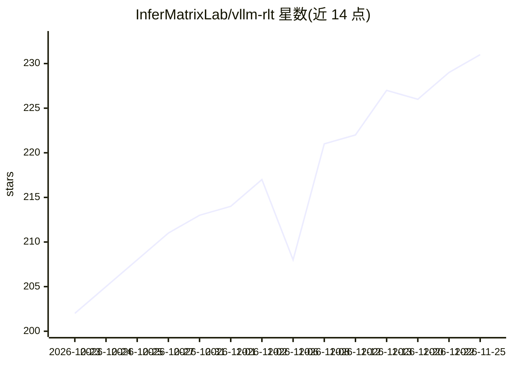

# InferMatrixLab/vllm-rlt

⭐ 231 · Python · Apache-2.0 · 推送 2026-11-20 · [GitHub](https://github.com/InferMatrixLab/vllm-rlt) · 组织维护 · 中文 README

**面向循环语言模型的循环级调度推理与服务引擎**

一个独立的循环语言模型推理与服务引擎：调度器按单个循环级别分配请求，不同深度的请求可共享批次而非等待整批完成。采用 Stage/Loop 架构，提供波前分块预填充（WCPB）、实验性 token 级自推测解码、深度感知分页 KV 缓存，以及 Python API、CLI 和 OpenAI 兼容的 completions 流式端点。当前为研究/评估里程碑，默认同步执行，高级模式为可选且受模型约束。

## 筛选速览

| 维度 | 判定 | 备注 |
|---|---|---|
| AI 角色 | `ai-ecosystem` | LLM/agent 周边工具 |
| 许可风险 | `permissive` | Apache-2.0 |
| 部署形态 | `library` | 以包/库形式分发 |
| 模型依赖 | — | README 未给出锁定关系 |
| 硬件要求 | — | 无带数字的原话,不猜 |
| 安装摩擦 | `medium` | 含编译或系统依赖之一 |
| 成熟度 | `idea` | |

## 能力要点

- 循环级连续批处理：不同深度请求共享批次
- WCPB 分块预填充与实验性 token 级解码流水线
- 深度感知分页 KV 缓存（LAST_EXITED/SHARED 布局）
- Python API、CLI 与 OpenAI 兼容 completions 流式端点

## 适用场景

- 运行 Ouro、Huginn 等循环语言模型的推理
- 在共享批次中混排不同循环深度的请求
- 研究深度自适应推理与提前退出策略

## 场景标签

`推理引擎` · 领域:训练与推理

## 证据(README 行号)

> L27: **vllm-rlt** is a standalone inference and serving engine for **recurrent
> L30: to finish. Its engine organization is inspired by vLLM, but it runs independently
> L71: - **Offline and online use:** Python API, CLI, and a streaming

## 星数曲线

2026-10-23 202 → 2026-11-25 231（+29）

---
*卡片 v1 · prompt 1.4 · 生成 2026-11-25 · 置信度 mid · 依据 README sha `dd52855385dc` · [字段定义](../../DATASET.md)*
