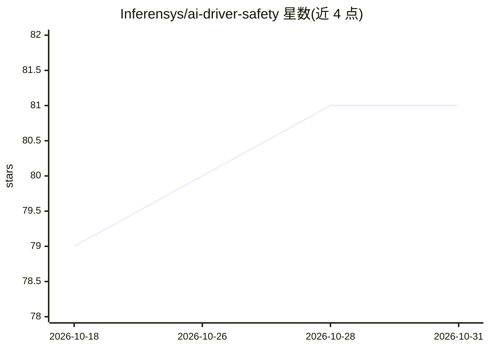

# Inferensys/ai-driver-safety

⭐ 81 · Python · NOASSERTION · 推送 2026-05-14 · [GitHub](https://github.com/Inferensys/ai-driver-safety) · 组织维护

**面向辅助/自动驾驶座舱的驾驶员疲劳分心实时监测系统**

基于计算机视觉与深度学习的驾驶员监测系统：读取座舱视频，经 MediaPipe 面部关键点与可选 ONNX YOLO11 目标检测，逐帧输出闭眼、打哈欠、瞌睡、分心、用手机的检测事件，并用模糊式风险评分（driver-risk-fusion-v1）融合视觉信号、生理信号与车辆遥测，生成标注 MP4、事件 JSON/CSV 与 HTML 报告及风险时间线。设计用于边缘设备实时运行，声明仅为研究与演示软件、非认证车规安全软件。安装方式为 git clone 源码加 pip -e 安装，模型权重需另行下载。

## 筛选速览

| 维度 | 判定 | 备注 |
|---|---|---|
| AI 角色 | `ai-native` | 本体是模型或模型工具 |
| 许可风险 | `none` | NOASSERTION |
| 部署形态 | `library` | 以包/库形式分发 |
| 模型依赖 | — | README 未给出锁定关系 |
| 硬件要求 | — | 无带数字的原话,不猜 |
| 安装摩擦 | `low` | 无编译、无系统依赖或容器化 |
| 成熟度 | — | 结构信号不足 |

## 能力要点

- 座舱视频逐帧检测闭眼/哈欠/瞌睡/分心/手机使用
- driver-risk-fusion-v1 风险评分融合视觉、生理与遥测信号，输出可解释 DetectionEvent
- 生成标注 MP4、事件 JSON/CSV、汇总 JSON 与 HTML 报告
- 支持 CLI、webcam 模式与 Python API 三种使用方式

## 适用场景

- 研究自动驾驶座舱内的驾驶员疲劳与分心检测
- 对真实驾驶视频批量生成风险时间线与事件报告
- 演示视觉+生理+遥测多信号融合的监测方案

## 场景标签

`目标检测` · 领域:感知与多模态

## 证据(README 行号)

> L10: We present a **driver monitoring system** for assisted and autonomous vehicle cabins. It turns cabin video into a f
> L16: Using Computer Vision & Deep Learning, we can analyze the driver’s behavior and detect signs of fatigue, distractio

## 星数曲线

2026-10-18 79 → 2026-10-31 81（+2）

---
*卡片 v1 · prompt 1.4 · 生成 2026-10-24 · 置信度 mid · 依据 README sha `d20ec2461b96` · [字段定义](../../DATASET.md)*
